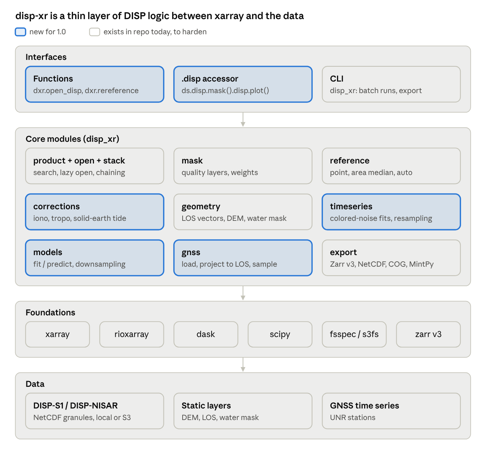
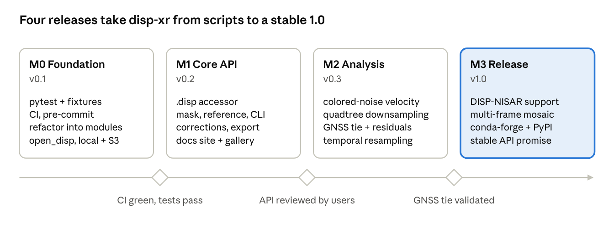

# disp-xr — Product Requirements Document

Oct 1, 2026

## Overview

disp-xr will be the xarray-native toolkit for OPERA DISP products (DISP-S1 and DISP-NISAR, both supported at 1.0): open, stack, mask, reference, correct, analyze and export displacement time series in a few lines of Python.

Today each user rebuilds the same glue: parsing filenames, chaining ministacks across reference-date changes, applying quality masks, re-referencing, and converting to MintPy. The current repo (about 2,100 lines in `src/disp_xr`) already does much of this, but as loose functions with no tests, no stable API and no docs.

The product is a small, composable library in the spirit of [xarray](https://xarray.dev), [rioxarray](https://corteva.github.io/rioxarray/) and [verde](https://github.com/fatiando/verde): plain functions and a `.disp` accessor on xarray objects, estimator classes with `fit`/`predict` for spatial models, and a gallery of worked examples.

## Goals and non-goals

Goals

1. Go from a folder or S3 prefix of DISP granules to one analysis-ready, lazily loaded `xr.Dataset` (time, y, x) with CRS, in one call.
2. Make the core DISP operations one-liners: quality masking, re-referencing (point, area, GNSS), ministack chaining, unit and LOS conversions.
3. Provide spatial models (trends, interpolators, GNSS-tie corrections) as disp-xr's own `fit`/`predict` estimators. verde is the design reference only, not a dependency.
4. Scale from a laptop subset to a full frame on dask, without code changes.
5. Export to the formats people already use: GeoTIFF, Zarr, NetCDF, MintPy HDF5.
6. Ship tested, documented, versioned releases on conda-forge and PyPI.

Non-goals

- Producing DISP products (that is [dolphin](https://github.com/isce-framework/dolphin) and the OPERA SAS).
- A GUI or web app; notebooks and a small CLI are the interfaces.
- General-purpose InSAR time-series inversion; MintPy stays the tool for that.
- A dependency on opera_utils. The DISP product logic disp-xr needs (filename parsing, CMR search, remote open and credentials, rebasing, referencing, quality masks, static-layer stitching, MintPy export) is ported into disp-xr with attribution, so disp-xr owns and tests it. [porting.md](porting.md) lists each function.
- A general-purpose download manager. disp-xr only searches for and opens DISP and static-layer granules.

## Users and use cases

| User | Typical task | What they need from disp-xr |
| --- | --- | --- |
| InSAR scientist (notebook) | Velocity map and time series over a volcano, fault or city | Open a frame, mask, re-reference, plot in under 10 lines |
| OPERA cal/val team | Compare DISP to GNSS; validate requirements across many frames | Reproducible GNSS tie, residual statistics, batch runs on dask or AWS |
| Product team | Compare DISP versions, inspect quality layers | Side-by-side stacks, quality-metric summaries |
| Downstream application user (hydrology, infrastructure) | Subsidence rates over an area of interest | Clip to AOI, export GeoTIFF/Zarr, simple velocity fits |
| MintPy user | Continue processing in MintPy | Faithful export of timeseries and geometry HDF5 |

## Functional requirements

Every row ships by 1.0. Priority gives the build order: P0 first, because later rows depend on it. Most P0 items harden code that already exists in the repo or port it from opera_utils.

| ID | Area | Requirement | Priority | Exists today |
| --- | --- | --- | --- | --- |
| F1 | Discover | Parse DISP filenames into a table (frame, dates, version); drop duplicates, keep the latest version | P0 | `product.get_disp_info` |
| F2 | Open | `open_disp(paths or S3 prefix)` returns a lazy `xr.Dataset` with CRS, time, reference_time and all layers; product groups open as an `xr.DataTree`. Granules that differ in dtype or encoding (mixed production versions) are refused with a message naming the groups | P0 | `stack.combine_disp_product` (local only) |
| F3 | Stack | Chain ministacks across reference-date changes into one cumulative series from the first epoch | P0 | `stack.combine_disp_product` |
| F4 | Mask | Apply recommended quality masks (recommended_mask, temporal coherence, connected components, water) with tunable thresholds | P0 | `quality_metrics` (partial) |
| F5 | Reference | Re-reference to a point, an area median, or the auto-selected most stable pixel | P0 | `utils.find_reference_point` |
| F6 | Correct | Optional corrections: ionosphere and solid-earth tide layers shipped in the product, and a user-supplied troposphere layer. Corrections already applied by the processor (ionosphere in DISP-NISAR) are never applied twice | P1 | none |
| F7 | Geometry | Static layers: LOS unit vectors, incidence/azimuth, DEM, layover/shadow (DISP-S1-STATIC, or stitched CSLC-S1-STATIC); water mask from the granules | P1 | `static_layers` |
| F8 | Time series | Velocity and seasonal fits (linear, annual, semiannual, steps) with uncertainties | P0 | Branch `timeseries_fitting` |
| F9 | Spatial models | Native fit/predict estimators (verde API as reference, no dependency): planar/polynomial trend, GNSS tie (fit DISP minus GNSS, predict correction), gridding of point data | P0 | none |
| F10 | GNSS | Load GNSS time series, project to LOS, sample DISP at stations, with geepers as the engine (`gnss` extra) | P0 | geepers |
| F11 | Multi-frame | **Dropped (2026-10-11): out of scope for 1.0.** Mosaic adjacent frames on a common grid. The default CRS is the UTM zone that holds the largest share of valid pixels; the caller can pass another. A mosaic wider than two UTM zones requires an explicit CRS. Regional products are downsampled per frame first (S2) and mosaicked at the coarse level, so 30 m data is never reprojected for them | P2 | none |
| F12 | Export | GeoTIFF, Zarr, NetCDF, MintPy HDF5 | P1 | `io`, `mintpy` |
| F13 | Plot | Quick-look maps and point time series via the accessor | P2 | none |
| F14 | CLI | Small `disp_xr` command line (`info`, `stack`, `export`, `geometry`) that wraps library functions and holds no logic | P1 | `cli/geometry.py` (empty) |
| F15 | Plate motion | Remove rigid plate motion (ITRF2014 plate model) from LOS displacement and velocity, for comparison with GNSS in a plate-fixed frame | P2 | none |
| F16 | Search | Find DISP granules in CMR by frame, version and dates, for DISP-S1 and DISP-NISAR | P1 | `download.py` (S1 only) |

## Cal/Val science features

Four Cal/Val capabilities go beyond the core: colored-noise velocities, quality-weighted downsampling, temporal resampling, and better residual analysis. Each reuses logic already proven in `geepers` (`00_tools/src/geepers`) or `tests/temporal_denoising`, ported to vectorized xarray so it runs per pixel on a full frame.

| ID | Feature | Reuses | New in disp-xr |
| --- | --- | --- | --- |
| S1 | Colored-noise velocity | geepers `trend.estimate_trend` (Hector-style MLE; PLWN, FNWN, RWFNWN; seasonal, steps, postseismic) | Per-pixel at frame scale, not per station |
| S2 | Quality-weighted quadtree downsampling | geepers `quality`, `weighted_median`, structure function | Quadtree on 30 m rasters; output at 1, 2 or 10 km |
| S3 | Temporal resampling and denoising | `temporal_denoising`: gated Kalman + RTS, robust LOWESS, break handling | Regular time grid with refused gaps, as an xarray op |
| S4 | Residual analysis | geepers `analysis`, `validation`: pairwise RMSE vs distance, epoch RMSE, semivariogram | Uncertainty-aware, per-epoch and per-pixel, on xarray |

### S1. Velocity with colored noise

- Trajectory model: polynomial, annual and semiannual terms, steps, and log/exp postseismic terms, as in geepers.
- Noise models WN, FNWN, PLWN and RWFNWN, estimated by MLE or Whittle. Outputs: velocity, its colored-noise sigma, kappa, noise amplitudes, AIC/BIC, residuals and model, all as `xr.Dataset` layers.
- The full-frame trick: the covariance depends only on the epochs, the valid-data pattern and the noise parameters, not on the pixel values. So noise parameters are estimated on quadtree cells (S2) or coherence bins. Then one Cholesky factor per (pattern, noise class) drives a batched GLS over millions of pixels.
- Fallbacks: per-pixel Whittle (FFT, vectorized over pixels) and MIDAS for robust rates.
- Because S3 found that "no filter improves a velocity", S1 always fits the raw series. Denoised series are for display and resampling only.

### S2. Quality-weighted quadtree downsampling

The goal is to take 30 m DISP to 1, 2 or 10 km for regional work, keeping spatial structure and trusting only reliable pixels.

- Weights: a pixel weight built from DISP quality layers; the default set is phase similarity, temporal coherence and time-series inversion residuals (residuals inverted so that low residual means high weight), and other layers can be added. Each layer maps to a 0 to 1 weight and the weights combine as described under Quality weights below.
- Aggregation per cell: weighted mean or weighted median for displacement and velocity. Mask and label layers use mode or "any", never a mean. Each cell also gets an uncertainty, a valid fraction, and a cell quality score, mirroring geepers `StationQuality`.
- Cell uncertainty: the weighted spread divided by the square root of the effective sample count. Pixels in a cell are spatially correlated, so the effective count is not the simple (Σw)² / Σw²; that formula gives sigmas that are too small at 1 to 10 km. disp-xr estimates the correlation from an empirical variogram and derives the effective count from it, following xDEM (Hugonnet et al. 2022). Both sigmas are reported.
- Quadtree: a cell splits while its split metric exceeds a threshold and its children still hold enough reliable pixels, with minimum and maximum cell sizes set by the user. The quadtree pyramid uses factors of 2 from 30 m.
- Regular-grid mode uses odd integer factors: 33, 67 and 333 give 990 m, 2,010 m and 9,990 m. An odd factor puts each cell center exactly on a 30 m pixel center, so the grid transform of every level stays exact.
- Edges: partial blocks at the frame edge are padded, not trimmed, and their valid fraction records how much data they hold. Trimming would drop up to 1 km at 33x.
- Composability: a weighted median cannot be built from a coarser level, so every weighted-median level is computed from the 30 m data. A weighted mean can be rebuilt from a finer level only if that level stores the sum of weights and the sum of squared weights, so regular-grid levels store both.
- Order: downsampling runs after ministack chaining and re-referencing. Averaging series with different reference dates gives wrong values.
- Implementation: weighted reductions through `xarray.coarsen` and grouped reductions, chunked and lazy, with no Python recursion per cell.
- Outputs: a point table (centroid, value, sigma, n, quality), ready for S1 fits, GNSS comparison and modeling. Regular-grid mode also returns coarse rasters, written as a multiscale pyramid (C4).
- Hexagon mode: cells are hexagons instead of squares, either planar hexagons on the frame's UTM grid anchored at UTM (0, 0) (no new dependency) or Uber H3 global cells (optional `h3` extra, for merging frames across UTM zones). All six neighbors are equidistant and corner pixels are closer to the center than in a square of equal area (Birch et al. 2007), which suits variograms and GNSS cell comparison. Same per-cell statistics as regular-grid mode, output as a (cell, time) point table only: hexagons are not a raster, so they get no COG, pyramid or quadtree. `spacing` is the center-to-center distance (area 0.866 spacing²).

#### Quality weights

Phase similarity and temporal coherence are good near 1; the inversion residual is good near 0 and needs special handling, because dolphin solves the time-series inversion with an L1 norm.

| Layer | Good value | Varies in time | Mapping to weight |
| --- | --- | --- | --- |
| Phase similarity | 1 | No (per ministack) | Linear stretch from a floor to 1, clipped to 0..1 |
| Temporal coherence | 1 | No (per ministack) | Linear stretch from a floor to 1, clipped to 0..1 |
| Time-series inversion residual | 0 | Yes, one value per secondary date | Split into whole cycles and a fractional part (below) |

What the residual is, from dolphin `timeseries.py`: the network is inverted by least absolute deviations (ADMM, a fixed 20 iterations). For each date, the layer is the sum of absolute residuals over every interferogram that includes that date, in radians.

Why values cluster near multiples of pi: an L1 fit does not spread an unwrapping error across the network; it leaves the whole 2 pi jump in the residual of the bad interferograms. Values in between come from phase noise, closure-phase inconsistency from phase linking, and the fixed iteration count.

Proposed handling:

1. Normalize by network degree: divide each date's sum by the number of interferograms that touch that date, so dates with more connections are not penalized.
2. Decompose: cycles = round(r / pi), fractional part = abs(r / pi - cycles). Real data mostly clusters near whole numbers of r / pi; a per-frame histogram is still checked, and pixels far from any whole number are reported as hard to interpret rather than forced into a cycle count.
3. Cycle count down-weights, it does not mask: each whole cycle on a date multiplies that pixel's weight for that date by a penalty factor below 1 (default set in the trade study). The pixel and date stay in the aggregate, with less influence.
4. The fractional part maps to a continuous weight, for example exp(-f / f0), with f0 set from the trade-study frames.
5. Static summary per pixel: one minus the fraction of dates with a nonzero cycle count, used as the third static weight. More cycle jumps give a lower weight, never zero.

Combined weight, a weighted geometric mean so that one bad layer pulls the pixel down:

$$
w = \prod_i w_i^{a_i / \sum_j a_j}
$$

The user sets the exponents a_i (default equal) and an exclusion floor. The floor is tested on the phase-similarity and temporal-coherence weights only. The residual weight never excludes a pixel or a date: it only lowers the weight, and it is clamped to a small positive minimum so the combined weight stays above zero.

#### Trade study: split metric

Three candidate split metrics run through the same pipeline; 1.0 ships the winner as default and the other two as options.

| Candidate | Split when | Strength | Risk |
| --- | --- | --- | --- |
| Displacement | Weighted variance of cumulative displacement, summed over epochs, exceeds a threshold | Keeps transients and seasonal signal | Noisy epochs drive splits |
| Velocity | Weighted variance of per-pixel velocity exceeds a threshold | Cheap; matches regional rate maps | Misses non-linear and seasonal signal |
| Spatial structure | Structure function at the cell scale exceeds the noise level | Ties splits to correlation length, as in GPS Imaging | Costlier; needs a noise model |

Evaluation, per candidate and target size (1, 2, 10 km):

1. Reconstruction error: upsample cells back to 30 m and compare with the full-resolution field, for both velocity and displacement.
2. GNSS agreement at cell level using S4 (RMSE, normalized residuals).
3. Gradient preservation across known features (fault, subsidence bowl edge).
4. Cell count and runtime for a full frame.

Outcome (2026-10-09, `docs/studies/split_metric.md`): spatial structure is the
quadtree default. At equal point counts the regular grid of `downsample`
reconstructs better on every test frame, so the grid is the recommended
downsampling and the quadtree is for signals with sharp local gradients
(structure beats the grid only across the creeping San Andreas). Downsampling
works on unmasked data with quality weights; masking first agreed with GNSS
0.1 to 0.3 mm/yr better but covered 6 to 19% fewer cells.
5. Test frames: a flat, quiet site, a subsidence site and a tectonic site, DISP-S1 and DISP-NISAR.

### S3. Temporal resampling and denoising

- Two first-class methods, selected by a method argument (kalman or lowess); both ship in 1.0 with the same inputs and outputs, so they can run side by side on one stack. Kalman: a gated local-linear-trend Kalman filter with an RTS or fixed-lag smoother, tau 20 to 30 d. In the experiments it left 0.2% of an injected spike and kept 93% of a transient.
- LOWESS: robust LOWESS (bandwidth 60 d, 2 iterations), which evaluates natively at any time and is the natural choice for regular-grid output. Its spike rejection depends on sampling: about 0.1% of a spike survives at 12 d sampling, about 30% at 24 d.
- Regular grid: 15 d for true 12 d sampling, 30 d for 24 d sampling. Gaps longer than `max_gap_days` stay NaN; they are never interpolated.
- Breaks: a declared break list (from earthquake catalogs or user input) via segmentation or Kalman covariance inflation. Automatic break detection is out of scope for 1.0.
- Performance: the Kalman covariance recursion is computed once per frame, then about 4 array operations per pixel per epoch.

### S4. Residual analysis, improved

- Keep what geepers has: bias, MAD, RMSE and r2; pairwise differential RMSE vs distance with a requirement line; epoch RMSE to flag bad acquisitions; residual semivariogram.
- Fit GNSS and DISP with the same S1 estimator, so velocity residuals compare like with like and come with colored-noise sigmas.
- Report normalized residuals (residual divided by combined sigma) and chi-square per station, not only raw RMSE.
- Analyze residuals per epoch and in time, not only for velocity: residual time series, their spectra, and common-mode residuals.
- Compare at S2 cell level as well as at the station pixel window, so the effect of downsampling on accuracy is measured.
- Return results as `xr.Dataset` / DataFrame with plotting helpers, not only figures.

Per-pixel model diagnostics, ported from the upstream `timeseries_fitting` branch (`timeseries/_stats_analysis.py`) and the Brisbane stakeholder notebook:

- Residual maps: mean, standard deviation, skewness, kurtosis, Anderson-Darling normality statistic, and lag-N autocorrelation of displacement minus model.
- Coefficient significance: z-scores, two-tailed p-values and confidence intervals per coefficient from the fit's standard errors.
- EOF analysis of residuals or displacement (standard, varimax/promax-rotated, complex EOF) on a subset, as an optional extra.
- All of these stream over time-contiguous chunks without storing the model. The notebook version was too slow and memory-heavy at frame scale, and its stored model was twice the size of the displacement.

## API design principles

Three layers, each borrowed from a library users already know.

| Layer | Modeled on | Shape | Example |
| --- | --- | --- | --- |
| Functions | xarray top-level API | Pure functions that take and return xarray objects | `dxr.open_disp("s3://.../F11116/")` |
| Accessor | rioxarray `.rio` | `.disp` namespace on `Dataset`/`DataArray`, chainable | `ds.disp.mask("recommended").disp.rereference(lon=-118.2, lat=34.1)` |
| Estimators | verde gridders (design reference only) | Classes with `fit(coords, data, weights)`, `predict(coords)`, `grid(...)`, `score(...)`; composable with a `Chain` | `dxr.GNSSTie(degree=1).fit(gnss, ds).predict(ds)` |

Rules

- Never mutate inputs; every operation returns a new object and records what it did in `attrs["history"]`.
- Lazy by default: nothing calls `.compute()` except export and plotting.
- Coordinates and CRS always travel with the data (rioxarray `spatial_ref`); units in `attrs`, meters internally.
- One way to do each thing; names follow the DISP product spec (`displacement`, `temporal_coherence`, `reference_time`).
- Fixed processing order: corrections, then quality mask (both per product, before chaining), then chaining, then spatial reference. Masked values then propagate through the chain.
- Velocity fits use the raw series. A denoised series is tagged in its attributes, and the fit functions refuse it unless told otherwise.
- Metadata follows CF: every data variable has `grid_mapping`, `units` and `long_name`; mask and label layers carry `flag_values` and `flag_meanings`.
- Runtime settings (default chunks, memory limit, thread counts, quality thresholds) live in one `disp_xr.config` object with `DISP_XR_*` environment overrides, so batch jobs are configured without code changes.
- Data opens in the layout of the files (one epoch, one read block per chunk), and each operation gets the chunks it needs: selections read only what they touch, chaining keeps the input chunks, and per-pixel functions rechunk to whole time series themselves. `disp_xr.rechunk` switches layouts explicitly when one kind of access repeats.
- Every public function has a NumPyDoc docstring with a runnable example, as the repo's `CLAUDE.md` already requires.

## Architecture and dependencies

Each core module is a plain-function file; the accessor and the estimators are thin wrappers over those functions, so there is one implementation per operation. Of the 9 core modules, 5 harden existing code and 4 are new. Product parsing, search, remote open, chaining, referencing, quality masks and MintPy export are ported from opera_utils and owned by disp-xr; opera_utils is not a dependency.

## Cloud-native storage and the xarray/Zarr ecosystem

disp-xr follows current practice in the xarray and Zarr community: Zarr v3 on object storage, versioned stores, virtual references to existing NetCDF/HDF5 granules, and multiscale pyramids. The practices below were read from the source of the [Earthmover](https://github.com/earth-mover) repositories, [VirtualiZarr](https://github.com/zarr-developers/VirtualiZarr) and the [Zarr](https://zarr.dev/) documentation, and checked against the cited files. disp-xr implements them in its own code. Icechunk and VirtualiZarr are opt-in extras. [references.md](references.md) holds the full list with sources.

| ID | Capability | What disp-xr does | Reference |
| --- | --- | --- | --- |
| C1 | Zarr v3 output | The default analysis-ready store is Zarr v3 with sharding; layers use Blosc (zstd, bit shuffle), and quality layers (integer masks included) in time-spanning chunks and boolean layers use zstd (benchmark, plan task T37.3b). Two presets: `timeseries` (whole time axis per chunk) for per-pixel work, `maps` (one epoch per chunk) for viewing | [zarr.dev](https://zarr.dev/), [workshop-cng-2025-zarr](https://github.com/earth-mover/workshop-cng-2025-zarr) |
| C2 | Versioned stores (opt-in) | [Icechunk](https://github.com/earth-mover/icechunk) store: one commit per appended ministack, a tag per Cal/Val run, and the snapshot id recorded in provenance so any result can be reproduced | [icechunk](https://github.com/earth-mover/icechunk) |
| C3 | Virtual datasets (opt-in) | Index a whole frame as one store without copying DISP granules, via VirtualiZarr references kept in Icechunk. Used as an ingest and index layer; analysis runs on a native Zarr copy | [VirtualiZarr](https://github.com/zarr-developers/VirtualiZarr), [icechunk-nasa](https://github.com/earth-mover/icechunk-nasa) |
| C4 | Multiscale pyramids | Regular-grid levels from S2 are written as sibling groups with GeoZarr multiscales, `spatial:` and `proj:` metadata next to the CF `spatial_ref`. These conventions are at pilot maturity, so the writer lives in one module and records the convention version. A `bowser` profile writes stores that [bowser](https://github.com/opera-adt/bowser) opens directly (display levels by factor 2, NaN as missing, bowser attributes) | [icechunk-multiscales-demo](https://github.com/earth-mover/icechunk-multiscales-demo), [topozarr](https://github.com/earth-mover/topozarr) |
| C5 | Map serving | Gallery example that serves velocity and quality layers as web tiles from the pyramid; not part of the core package | [xpublish-tiles](https://github.com/earth-mover/xpublish-tiles) |
| C6 | Batch builds and benchmarks | Frame or region cubes are built by region jobs on dask or AWS Batch. Storage benchmarks measure the DISP access patterns | [serverless-datacube-demo](https://github.com/earth-mover/serverless-datacube-demo), [cloud-tensor-storage-benchmarks](https://github.com/earth-mover/cloud-tensor-storage-benchmarks) |
| C7 | Read-only REST service (opt-in) | An xpublish plugin (`serve` extra, `disp_xr serve STORE`) exposes a store over HTTP for web clients such as the DISP portal: point time series and velocities, downsampled or quadtree cells as GeoJSON, GNSS residual tables, provenance, and web tiles through xpublish-tiles. Read-only over existing stores; no processing runs on request (heavy work goes through region jobs, C6) | [xpublish](https://github.com/xpublish-community/xpublish), [xpublish-tiles](https://github.com/earth-mover/xpublish-tiles) |

### Storage rules

Writing (C1):

- Sizes come from byte targets, not fixed shapes. The shard is the unit of writing and equals one dask chunk, about 100 MB uncompressed: for a 300-epoch float32 stack, 256 x 256 in space over the whole time axis (79 MB). The chunk inside the shard is the unit of reading and is smaller, 5 to 20 MB: 64 x 64 over the whole time axis (4.9 MB) for `timeseries`, 1,024 x 1,024 of one epoch (4 MB) for `maps`.
- One chunk grid for all variables in a store, whatever their dtype. Shards are a whole multiple of chunks, and dask chunks are aligned to the shard shape before writing.
- A `timeseries` store holds the whole time axis in each chunk, so it is a frozen snapshot: appending an epoch would rewrite every shard. Stores that grow (C2) use a fixed time chunk of one ministack.
- Only codecs defined in the Zarr v3 specification are used by default, so other readers (GDAL, web clients) can open the output. Lossy rounding is opt-in.
- Consolidated metadata is written for plain stores but never required on read; it is still experimental in Zarr v3.
- Source encoding is dropped before writing, so HDF5 chunking and compression from the granules never leak into the output.
- Coordinates (`x`, `y`, `time`, `reference_time`) are written as single uncompressed chunks.
- Fill values and the CRS must survive a round trip: NaN for float layers, the product's nodata for masks, `spatial_ref` and `grid_mapping` intact.

Virtual stores (C3):

- A virtual store keeps the granules' chunking, one epoch per chunk at 256 x 256 with gzip. Reading one pixel's time series decompresses one chunk per epoch, so per-pixel fits and filters run on a native `timeseries` store, not on the virtual one.
- Granules are checked before they are combined: same variables, dtype, chunk shape and codecs. A frame that mixes production versions is refused; the caller selects one production.
- `time` and `reference_time` are loaded, not virtual, because their units differ between granules in the 2025 production. The large string datasets in `/identification` and `/metadata` are dropped.
- Displacement in a virtual store is still relative to each ministack reference. Chaining and re-referencing run lazily on top.

Versioned stores (C2):

- Provenance goes into commit metadata: disp-xr version, product version, frame, input granules and operations. Reference dates stay a coordinate, because commit metadata is invisible to xarray.
- A committed snapshot that provenance points to is never amended, and library code never expires snapshots or collects garbage.
- Parallel writers use region writes with fork and merge, and one commit per batch. Two jobs that both append along time conflict and cannot be rebased.

Batch builds (C6):

- The store is initialized once from a template. Region jobs are planned from the output encoding and aligned to shard boundaries, because the shard is the unit of safe parallel writing.
- Each region job owns its shards and overwrites them whole, so a retry is safe. Each job returns a result record, and the records form the manifest used to resubmit failures.
- The granule list is resolved once by the coordinator, not by each worker. Earthdata S3 credentials expire after about 1 hour, so long jobs refresh them.

On the xarray side:

- Products with groups (`/corrections`, `/identification`, `/metadata`) open as an `xr.DataTree`; multi-frame collections are a DataTree with one node per frame.
- Grouped reductions (per ministack, per coherence bin, per quadtree cell) use [flox](https://github.com/xarray-contrib/flox) through `groupby`, not Python loops.
- Per-pixel kernels (fits, filters, noise estimation) run through `xr.apply_ufunc(dask="parallelized")` on chunks that hold the whole time axis.

### Ecosystem libraries

disp-xr checked every project on the [xarray ecosystem page](https://docs.xarray.dev/en/latest/user-guide/ecosystem.html) and related projects for anything it can use. Nothing InSAR-specific can be a dependency: the SAR projects there work on SLC or point-scatterer data in radar coordinates. [references.md](references.md) section 3 has the full list.

| Library | Role in disp-xr | Level |
| --- | --- | --- |
| [rioxarray](https://github.com/corteva/rioxarray) 0.23 or later | CRS and transform; also writes the Zarr `spatial:` and `proj:` conventions | Core |
| [flox](https://github.com/xarray-contrib/flox) | Grouped reductions per ministack, bin and cell | Core |
| [numbagg](https://github.com/numbagg/numbagg) | Faster NaN-aware reductions when installed; never imported directly | Recommended |
| [geepers](https://github.com/opera-adt/geepers) | GNSS engine: station sources (UNR, UNR grid, sideshow), downloads and caching, DISP sampling at stations, LOS uncertainty | `gnss` extra |
| [xeofs](https://github.com/xarray-contrib/xeofs) | EOF analysis in the gallery; quiet since early 2025, so core code never imports it | `eof` extra |
| [odc-geo](https://github.com/opendatacube/odc-geo) | Lazy reprojection to a common grid for mosaics, to evaluate | Optional |
| [hvplot](https://github.com/holoviz/hvplot) | Interactive full-frame browsing in the gallery | `interactive` extra |
| [cf_xarray](https://github.com/xarray-contrib/cf-xarray) | Tests assert that outputs decode as CF | `test` extra |

Ideas copied without a dependency:

| From | Idea |
| --- | --- |
| [xDEM](https://github.com/GlacioHack/xdem) | Uncertainty of a spatial average when errors are spatially correlated (variogram-based effective sample count) |
| [stmtools](https://github.com/TUDelftGeodesy/stmtools) | Point tables as a (space, time) xarray Dataset, ordered in space for chunk locality |
| [SARXarray](https://github.com/TUDelftGeodesy/sarxarray) | Accessor layout on an SAR stack; multilooking through `coarsen` |
| [xclim](https://github.com/Ouranosinc/xclim) | One decorator that checks units, sets CF attributes and appends history around a plain function |
| [xarray-schema](https://github.com/xarray-contrib/xarray-schema) | Dataset validation by component schemas, including chunks |
| [xproj](https://github.com/xarray-contrib/xproj), [rasterix](https://github.com/xarray-contrib/rasterix) | CRS-aware alignment; grid access behind one helper so a raster index can replace it later |
| [xskillscore](https://github.com/xarray-contrib/xskillscore), [xarray-einstats](https://github.com/arviz-devs/xarray-einstats), [xarray-spatial](https://github.com/xarray-contrib/xarray-spatial) | Test oracles for statistics and interpolators |

## Non-functional requirements

| Area | Requirement |
| --- | --- |
| Performance | Opening a full frame is metadata-only (no pixel reads); dask chunk shape computed from a byte target (about 100 MB) and overridable |
| Scale | Same code runs on a laptop, a dask cluster and AWS Batch; reads local files or S3 via `s3fs`/`fsspec`; any Zarr store object can be passed for output |
| Memory | Full-frame masking, re-referencing and export stay within 8 GB per dask worker and 4 GB for the coordinator (decided 2026-10-06; see `docs/performance.md`) |
| Testing | pytest with small synthetic DISP fixtures; target 80% line coverage; doctests on every public example; CI on every PR |
| Typing and style | mypy clean, ruff + black via pre-commit (already configured) |
| Docs | mkdocs on GitHub Pages: getting started, API reference from type hints, a verde-style gallery of short worked examples |
| Packaging | Python 3.12+, conda-forge and PyPI; heavy extras optional (`[gnss]`, `[mintpy]`, `[plot]`, `[interactive]`, `[aws]`, `[cloud]`, `[eof]`); no opera_utils or verde dependency |
| Compatibility | Supports every released DISP-S1 product version and DISP-NISAR at 1.0; version checks fail early with a clear error |
| Provenance | Each output records the disp-xr version, the versions of xarray, zarr and dask, input granules and operations applied |
| Metadata | Outputs follow CF conventions, and Zarr outputs also carry GeoZarr `spatial:` and `proj:` attributes; both are tested against the rioxarray CRS and transform |
| Benchmarks | A benchmark suite times open, a single-pixel time series, a single-epoch map and a spatial window over all epochs, for NetCDF, native Zarr and virtual stores. At least 5 trials each, raw rows kept, results checked for correctness |
| Licensing | BSD-3-Clause. Ported opera_utils code keeps its copyright notice; no GPL code is copied |

## Milestones

M0 comes first because nothing else is safe to refactor without tests. Each diamond is a gate: the next milestone starts only when its criterion is met. Dates are an open question below.

## Open questions

- [x] Scope of 1.0: DISP-S1 only, or must DISP-NISAR be supported at launch? Decided: both.
- [x] Accessor name: `.disp`, or something less likely to clash? Decided: `.disp` (no installed library uses it; a test guards against clashes).
- [x] Should verde be a hard dependency, or should estimators follow its API without importing it? Decided: no dependency; disp-xr implements its own fit/predict estimators, using verde only as a design reference.
- [x] GNSS source: UNR only, or pluggable (UNR, NGL, local CSV)? Decided (2026-10-03): geepers is the GNSS engine. Its sources (UNR, UNR grid, sideshow, behind `BaseGpsSource`) load the series and its sampler reads DISP at the stations; disp-xr's `gnss` module adapts them to xarray `(station, time)` datasets and aligns them with DISP epochs and reference. No GNSS reader is re-implemented in disp-xr.
- [x] Keep MintPy export in core, or move it to an optional extra? Decided: `mintpy` extra.
- [x] Download: keep `download.py`, or defer to another package? Decided: the CMR search code stays in disp-xr as `search.py` (ported with attribution, extended to DISP-NISAR); `download.py` remains one release as a deprecated shim.
- [x] Home organization: opera-adt or OPERA Cal/Val? Decided (2026-10-06, by the OPERA ADT lead): the repository stays on `mgovorcin/disp-xr`, which can go public there; moving it to a project organization is decided later.
- [x] Maintainers and reviewers: to name. Decided (2026-10-11): the owner, Marin Govorcin (`@mgovorcin`), is the sole maintainer and reviewer for now (`.github/CODEOWNERS`).
- [ ] Target dates for each milestone.
- [x] Memory budget per dask worker for the full-frame target. Decided (2026-10-06): 8 GB per worker, 4 GB for the coordinator (plan task T37.1).
- [x] S1: should the S1 estimator live in disp-xr and geepers depend on it, or the reverse (one implementation shared by both)? Decided: inside disp-xr.
- [ ] S1: run a noise-model selection (AIC/BIC) per cell, or fix PLWN as default? Proposed in T23, awaiting confirmation: PLWN by default, with `fit_velocity(method="gls", noise="auto")` choosing FNWN, PLWN or RWFNWN per group by the median BIC of its sampled pixels.
- [x] S2: default quality layers for the pixel weight? Decided: phase similarity, temporal coherence, time-series inversion residuals; cycle jumps in the residuals down-weight and never mask.
- [x] S2: default exponents, cycle penalty, f0, per-layer floors and the exclusion floor (set by the trade study). Decided (2026-10-09, T29): unchanged. Penalty and f0 make no measurable difference at 1-10 km; floors stay at the processor's thresholds on `recommended_mask`; exponents equal. A coherence floor of 0.8 is the documented opt-in for Cal/Val accuracy runs (better GNSS agreement, 12-39% fewer pixels). The similarity floor and the minimum residual weight were not swept.
- [x] S2: quadtree split metric: velocity variance, displacement variance over time, or structure function? Decided: trade study of all three (see S2). Outcome (2026-10-09): structure function by default; the regular grid is the recommended downsampling.
- [ ] S3: test denoising on a deforming site with topography-correlated troposphere; experiments so far cover one flat, aseismic site (Kiritimati).
- [x] S4: which OPERA requirement thresholds to draw on the residual plots? Decided (2026-10-04): both DISP-S1 requirements, by default: relative displacement 3 (1 + sqrt(L)) mm on the pairwise RMSE profile, and relative velocity 2 mm/yr on station-pair differences of velocity residuals, for 0.1 km < L < 50 km (`residuals.DISP_S1_DISPLACEMENT`, `DISP_S1_VELOCITY`). The values were to be confirmed against the OPERA requirements document before v0.3; they shipped in v0.3.0 unconfirmed, and confirming them remains open.
- [x] Cloud: should Icechunk be the default store for analysis-ready outputs, or an opt-in extra? Decided: follow the earth-mover practices; Icechunk is opt-in where useful.
- [x] Depend on opera_utils for product parsing, rebasing and referencing? Decided: no; port the needed functions into disp-xr with attribution.
- [ ] DISP-NISAR: filename pattern, CMR short name and ASF credential endpoint are unconfirmed until a real granule is inspected.
- [x] Multi-frame mosaics: adjacent frames can be in different UTM zones. Which CRS does the mosaic use? Decided: the UTM zone that holds the largest share of valid pixels, unless the caller passes a CRS; see F11.
- [x] A frame can mix production versions with different dtypes (float32 and float64 displacement were both seen). Should `open_disp` cast to one dtype, or refuse? Decided: refuse, and name the groups so the caller can select one production.
