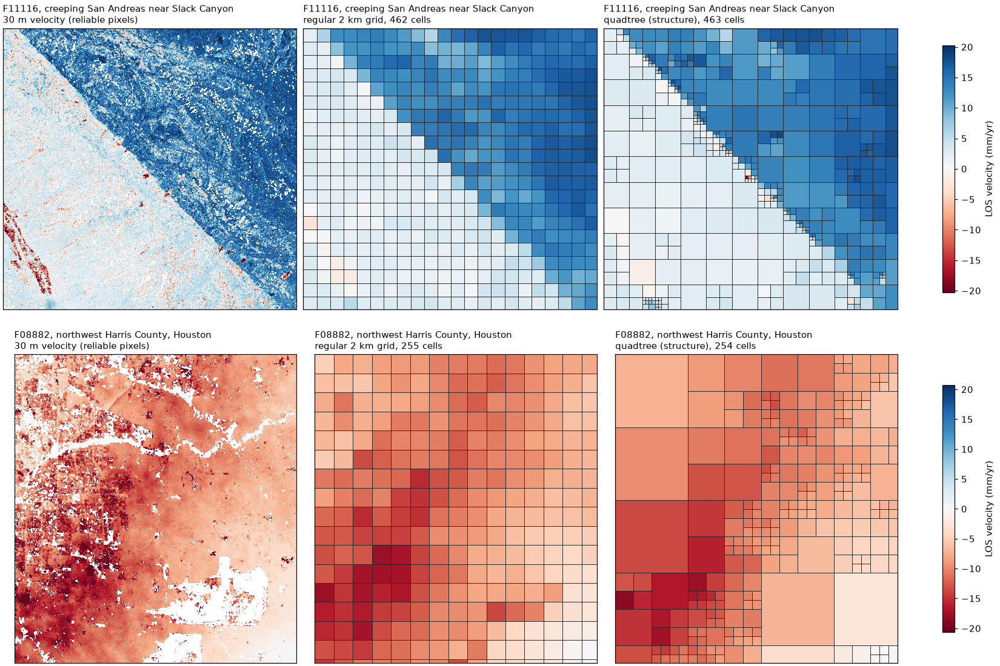

# Split metric and weight defaults (T29)

Status (2026-10-10): done. Runs finished on 2026-10-06; decision taken
with the maintainer on 2026-10-09 (see "Decision"). The follow-up on a
noise-normalized split metric (T28.6) ran on 2026-10-10; it does not
change the decision, and the metric was dropped (see "Follow-up:
noise-normalized metric").

This study picks the default quadtree split metric (`displacement`,
`velocity` or `structure`, T28) and the T26 weight parameters (`penalty`,
`f0`, floors, exponents, and the minimum residual weight of T26.6). It
compares them at 1, 2 and 10 km cells on four criteria:

1. reconstruction error against the 30 m field (velocity and displacement),
2. GNSS agreement per cell (T32),
3. gradient preservation across known features,
4. cell count and runtime.

Scripts and inputs live in `studies/split_metric/` at the repository root.

## Frames

Three DISP-S1 frames, one per kind of signal. Details (paths, bounds,
dates, product version and why each was chosen) are in
`studies/split_metric/frames.yaml`.

| Frame | Role | Site | Granules | Dates | GNSS used / inside |
| --- | --- | --- | --- | --- | --- |
| F08882 | subsidence | Houston, upper Texas Gulf Coast | 269 | 2016-09 to 2026-02 | 97 / 144 |
| F11116 | tectonic, topography-correlated troposphere | Central California: creeping San Andreas, San Joaquin Valley | 389 | 2016-07 to 2026-04 | 126 / 151 |
| F39362 | quiet (troposphere control) | Canberra and the Snowy Mountains | 247 | 2016-07 to 2025-04 | 25 / 34 |

- F11116 spans the November 2025 production change: 75 of its 389
  granules store displacement as float64, the rest as float32. They are read
  together (see the product notes).
- F08882 is also the cal-disp frame, so GNSS results can be compared with
  that work.
- F11116 has a sharp velocity step at the creeping fault trace, the
  gradient-preservation test case for a tectonic signal. With the Coast
  Ranges and Sierra foothills it is also the deforming site with
  topography-correlated troposphere that T31.7 asked for.
- F39362 is the control: little deformation but about 1500 m of relief from
  the coast to the Snowy Mountains, so troposphere that follows elevation
  shows up without a deformation signal under it. Its granules are product
  version 0.10 (a stakeholder run outside North America), not 1.0.

New Orleans (F44055) was considered and dropped: it is a second subsidence
site and has no GNSS prepared.

### GNSS stations

`studies/split_metric/stations.py` writes `stations/<frame>.csv`: the UNR
stations inside each frame's grid over the frame's dates, with first and
last day, number of daily solutions and the share of the DISP span covered.
A station is used (`use = True`) when it covers at least half of the span
and has at least 2.5 years of data.

`gnss_los.py` projects each used station's daily east, north and up onto
the line of sight at its pixel and fits a MIDAS velocity over the frame's
dates (`stations/<frame>_los.csv`). LOS vectors come from DISP-S1-STATIC
for F08882 and F11116. Canberra has no DISP-S1-STATIC, so its LOS layers
come from the stakeholder run, built from CSLC-S1-STATIC bursts on the same
grid as the granules. Six Canberra stations fall outside the valid LOS
coverage, which leaves 19.

### DISP-NISAR frames for T35.5

Frames of the Whirlwind NISAR campaign, which already has GNSS for each:

| NISAR frame | Pairs with | GNSS stations |
| --- | --- | --- |
| 042_D_070 | F11116 (same area) | 232 |
| 062_A_016 | F08882 (same area) | 100 |
| 133_A_022 | F39362 (no campaign frame covers Australia; a quiet site with moderate relief in the US Northeast instead) | 77 |

## Inputs

`prepare.py` builds one study stack per frame, following `disp_xr stack`:

- product corrections;
- the recommended mask;
- chaining of the ministacks;
- a reference.

It keeps the displacement and the three quality layers and every third
epoch: 91 epochs for F08882, 84 for F39362, 130 for F11116. Cumulative
displacement stays valid on a subset of epochs. It also writes an OLS
velocity, which is the 30 m reference for the velocity criteria and the
input of the velocity split metric.

Two choices differ from the command line, both for run time on full
frames. The study only compares methods with each other, so neither
changes its results.

- **Reference.** The median of a 2 km box around a GNSS station near the
  frame center (UHEB, TURO, ...) instead of `auto`, whose stable-point
  search reads every quality layer of every epoch first.
- **Floors.** The weight floors default to the product's own quality
  thresholds (`similarity_threshold`, `temporal_coherence_threshold` on
  `recommended_mask`), as `quality_weights` does. These differ between
  granules and frames, so the most common values are recorded on each
  stack: 0.6 and 0.7 for F08882, 0.5 and 0.6 for F39362.

## Two arms: unmasked (primary) and masked

Decision of 2026-10-05: downsampling works on unmasked data, and the
quality weights do the quality work (as the PRD's S2 decision asks: cycle
jumps down-weight, never mask). The primary arm therefore builds stacks
with only water removed (`water_mask`). The masked arm applies the
recommended mask, as `disp_xr stack` does by default, and is the
comparison: if the unmasked, weighted arm does at least as well on GNSS
agreement and gradient preservation, the defaults move to unmasked
downsampling. Set the arm with `DISP_XR_STUDY_VARIANT=unmasked|masked`.

## Reliable pixels

The recommended mask is applied per epoch and varies in time, so most
pixels of the masked arm are valid in only part of the series: on F08882 only 15% of pixels
are valid in at least half of the 91 epochs, on F39362 14% of 84. A
velocity fit to a handful of epochs is noise, with sigmas of hundreds of
mm/yr. The study treats pixels valid in fewer than half of the epochs (the
stack's zero epoch not counted) as missing, before downsampling and in
every criterion. On the pixels kept, velocities look like the sites:
95th percentile |v| 11 mm/yr on F08882 and 4 mm/yr on F39362, median sigma
about 1 mm/yr.

A first run without this rule (2026-10-04) is not valid: its 30 m GNSS
floor on F08882 was 203 mm/yr, and the split metrics followed the noisy
pixels.

## Design: equal point budgets

A metric that splits more always reconstructs better, so the metrics are
compared at equal point counts:

- **Regular grid.** For each cell size (1, 2 and 10 km, factors 33, 67
  and 333), `downsample` gives the regular grid. Its number of cells with
  data is the point budget.
- **Quadtrees.** Each split metric then builds a quadtree with the same
  budget (`quadtree(n_points=...)`, which picks the threshold whose leaf
  count is closest). Levels run from 3 (240 m) to 10 (30 km).

The regular grid is the baseline: a quadtree metric is worth its cost only
where it beats the grid at the same number of points.

## Criteria

Each partition (grid or quadtree) is painted back on the 30 m grid through
its leaf-id raster: every pixel takes the value of its cell. Then:

1. **Reconstruction.** The RMSE against the 30 m field over reliable pixels
   (static weight above zero, data at some epoch). For displacement it is
   the RMS over epochs, and also given for the last epoch. For velocity,
   each cell's velocity is the weighted mean of the 30 m velocity.
2. **GNSS agreement.** The cell velocity at each station minus its LOS
   velocity, as an RMS after removing a plane in x and y. DISP is relative
   to its reference and GNSS is absolute, and plate motion on a line of
   sight that changes across the frame is a ramp. The `full` row gives
   the same number for the 30 m pixel at each station, the floor the
   partitions are measured against.
3. **Gradient preservation.** Along straight profiles across known features
   (`profiles` in `frames.yaml`), a 1 km swath is binned every 300 m. The
   criterion is the RMSE between the binned 30 m velocity profile and the
   painted one. The profiles are:
   - three 30 km profiles across the creeping San Andreas (F11116);
   - one across the northwest Harris County subsidence (F08882);
   - one from the coast up to the Snowy Mountains (F39362).
4. **Cost.** The number of points and the seconds to build the partition.

## Weight sweep

`run.py --sweep` varies the quality-weight parameters one at a time around
the defaults of `quality_weights`:

- `penalty` 0.25, 0.75, 1 (no penalty);
- `f0` 0.1, 0.5;
- `min_residual` 0.01, 0.2;
- the similarity floor 0.2, 0.5;
- the coherence floor 0.5, 0.8;
- without the residual layer;
- equal weights.

It runs at 2 km on the grid and on the frame's best split metric (by the
sum of its ranks on criteria 1 to 3). The weights change cell means much
more than which metric wins, and the sweep is the costly part of the
study.

## Running it

```bash
cd studies/split_metric
pixi run -e test-py312 python stations.py      # station lists
pixi run -e test-py312 python gnss_los.py      # GNSS LOS velocities
pixi run -e test-py312 python prepare.py F08882 F39362 F11116
pixi run -e test-py312 python run.py F08882 F39362 F11116
pixi run -e test-py312 python run.py --sweep F08882 F39362 F11116
```

`prepare.py` and `run.py` run dask on 24 local processes. Granule reads
hold the HDF5 lock, and zarr decodes in one thread per process, so threads
ran at about one core. The stacks are about 22 GB each.

## Found along the way

The study turned up five problems in disp-xr, each fixed with a test:

- quadtree cells on the frame edge never split;
- functions that align chunks failed on stacks read back from Zarr;
- `quality_weights` loaded the whole residual stack into memory;
- `rereference("area")` read the whole frame for a small box;
- `open_disp` refused (and could not chain) frames that span the November
  2025 production change. The product notes have the details;
- `fit_velocity`, `fit_trajectory` and `downsample` outputs lacked
  `grid_mapping` (found serving tiles).

## Results

Raw rows: `studies/split_metric/results/` (`<frame>_unmasked.csv`,
`<frame>_unmasked_sweep.csv`, and `<frame>_masked.csv` for the masked arm,
which was stopped after the 2 km size). Reconstruction errors are against
each arm's own 30 m field, so they compare methods within an arm, not arms
with each other; GNSS agreement uses the same stations in both arms.

### Grid against quadtrees (unmasked arm, equal point counts)

Displacement RMSE (mm), velocity RMSE (mm/yr), GNSS RMS after a plane
(mm/yr) and profile RMSE (mm/yr). Best of each column per frame and size in
bold.

| Frame, size | Method | Disp. | Vel. | GNSS | Profile |
| --- | --- | ---: | ---: | ---: | ---: |
| F08882, 1 km | grid | **26.6** | **4.01** | **1.52** | **2.43** |
| | displacement / velocity / structure | 39.4 | 6.30 | 2.94 | 3.59 |
| F08882, 2 km | grid | **30.5** | **4.50** | **1.51** | **2.67** |
| | best quadtree (structure) | 39.3 | 6.32 | 2.92 | 3.61 |
| F11116, 1 km | grid | **31.2** | **4.80** | 2.76 | 1.31 |
| | structure | 35.6 | 5.65 | **2.59** | **1.20** |
| F11116, 2 km | grid | **33.5** | **5.27** | 2.71 | 1.95 |
| | structure | 36.9 | 5.91 | **2.47** | **1.75** |
| F39362, 1 km | grid | **19.3** | **3.40** | 1.15 | **1.11** |
| | velocity | 23.1 | 3.68 | **0.75** | 1.73 |
| F39362, 2 km | grid | **20.5** | **3.51** | 1.39 | **1.26** |
| | velocity | 23.4 | 3.75 | **0.61** | 1.76 |

The 30 m GNSS floor (each station's own pixel) is 1.85, 3.84 and 1.12 mm/yr:
averaging into cells beats it on the two noisier frames.

- The regular grid reconstructs the 30 m field best on every frame and
  size, and wins every criterion on the subsidence frame.
- Among the quadtree metrics, `structure` is the best overall. On the
  creeping-fault frame it beats the grid on GNSS agreement and on the three
  fault profiles at 1 and 2 km, the case quadtrees are meant for.
- The `displacement` and `velocity` metrics are variances in data units,
  so noisy cells always look heterogeneous. On F08882 their trees are
  degenerate: about 37,000 cells at the finest level (240 m) in a few
  places and 52 cells of 30 km elsewhere, with almost nothing between. The
  point budget goes to noise. `structure` compares the spread of the four
  child means with their noise, which is why it does better, but at the
  same budget it still loses to the grid where the signal is smooth.
- The quadtrees' GNSS wins on the quiet frame (0.6 to 0.75 mm/yr) come
  from very large cells averaging nearly zero velocities, not from
  resolving anything; 19 stations.



The 30 m velocity, the regular 2 km grid and the `structure` quadtree with
the same number of cells, on two 45 x 40 km windows (unmasked arm; made
with `studies/split_metric/figure.py`). Across the creeping San Andreas
(top) the quadtree puts its smallest cells along the trace and keeps the
step sharp, where the grid smears it into 2 km blocks. Over Houston
(bottom) it spends its cells on the patchy northeast and gives the deepest
subsidence, in the southwest, large blocks: the split follows
heterogeneity, much of it noise, rather than the deformation gradient
(plan task T28.6).

### Masked against unmasked arm

| Frame, size | GNSS, unmasked | GNSS, masked | Grid cells, unmasked | masked |
| --- | ---: | ---: | ---: | ---: |
| F08882, 1 km | 1.52 | **1.32** | 39,967 | 32,988 (-17%) |
| F08882, 2 km | 1.51 | **1.30** | 10,048 | 9,444 (-6%) |
| F39362, 1 km | 1.15 | **1.04** | 29,988 | 24,225 (-19%) |
| F39362, 2 km | 1.39 | **1.07** | 7,592 | 6,848 (-10%) |

The masked arm agrees with GNSS 0.1 to 0.3 mm/yr better and covers 6 to
19% fewer cells. By the rule set before the runs (move to unmasked if it
does at least as well on GNSS), the unmasked arm does not win outright.
In the masked arm the quadtree cannot reach the point budget at all: too
few cells have four reliable children (8,858 cells on F08882 at any
threshold).

### Weight sweep (2 km, grid and the frame's best quadtree)

| Variant | Effect |
| --- | --- |
| `penalty` 0.25 or 1, `f0` 0.5 | No measurable change on any frame (within 0.1 mm and 0.01 mm/yr). |
| Without the residual layer | Within noise: grid GNSS 0.05 to 0.08 mm/yr better, displacement RMSE 0.1 to 0.2 mm worse. |
| Equal weights | Worse everywhere: grid GNSS 2.37 against 1.51 (F08882), 2.95 against 2.71 (F11116), 1.53 against 1.39 (F39362). |
| Coherence floor 0.5 | Keeps more pixels, worse GNSS (1.77 on F08882). |
| Coherence floor 0.8 | Better GNSS on all three frames (1.46, 2.63, 1.21) but keeps 12 to 39% fewer pixels. |

The similarity-floor and `min_residual` variants were cut when the sweep was
trimmed for run time and are untested.

## Follow-up: noise-normalized metric (T28.6)

The `displacement` and `velocity` metrics are variances in data units, so
noisy cells score high and, at a fixed point budget, the leaves go to noise.
On F08882 at 1 km, 94% of the leaves sit at the finest level (240 m).
A prototype split metric, `normalized`, divided each cell's weighted spread
by the spread its pixels' noise alone would give, a reduced chi-square per
cell:

- pixel noise variance was `sigma0**2 / w`, with `w` the quality weight;
- `sigma0` per epoch was the median spread of the finest cells.

It ran against the regular grid at 1 and 2 km on the unmasked arm. The
results are in `results/<frame>_unmasked_normalized.csv`. The prototype,
its tests and `run.py --normalized` are in commit `1ad71bd` (plan task
T28.6's pull request). The rerun of the grid reproduces the T29 numbers
exactly.

Errors, lower is better; mm for displacement (RMS over epochs), mm/yr for
the rest:

| Frame | Size | Method | Displacement | Velocity | GNSS | Profile | Leaves at 240 m |
| --- | --- | --- | --- | --- | --- | --- | --- |
| F08882 | 1 km | grid | **26.6** | **4.01** | **1.52** | **2.43** | |
| | | normalized | 39.4 | 6.30 | 2.94 | 3.60 | 94% |
| | | displacement | 39.4 | 6.30 | 2.94 | 3.59 | 94% |
| | | structure | 39.3 | 6.30 | 2.94 | 3.59 | 94% |
| F08882 | 2 km | grid | **30.5** | **4.50** | **1.51** | **2.67** | |
| | | normalized | 39.3 | 6.32 | 2.95 | 3.66 | 63% |
| | | structure | 39.3 | 6.32 | 2.92 | 3.61 | 36% |
| F11116 | 1 km | grid | **31.2** | **4.81** | 2.76 | 1.31 | |
| | | normalized | 36.7 | 5.91 | **2.46** | 2.05 | 84% |
| | | structure | 35.6 | 5.65 | 2.59 | **1.20** | 17% |
| F11116 | 2 km | grid | **33.5** | **5.27** | 2.71 | 1.95 | |
| | | normalized | 39.4 | 6.43 | 2.97 | 4.13 | 65% |
| | | structure | 36.9 | 5.91 | **2.47** | **1.75** | 1% |
| F39362 | 1 km | grid | **19.3** | **3.40** | 1.15 | **1.11** | |
| | | normalized | 23.2 | 3.74 | 0.87 | 1.66 | 81% |
| | | velocity | 23.1 | 3.68 | **0.75** | 1.73 | 94% |
| F39362 | 2 km | grid | **20.5** | **3.51** | 1.40 | **1.26** | |
| | | normalized | 23.5 | 3.78 | 0.83 | 1.72 | 73% |
| | | velocity | 23.4 | 3.75 | **0.61** | 1.76 | 92% |

**`normalized` does not fix what it was meant to fix.**

- It still puts 63 to 94% of its leaves at the finest level, close to
  `displacement`. On F08882 at 1 km its leaves are identical to
  `displacement`'s.
- The pixel noise it divides by is spatially white. What drives the
  splits is spatially correlated (atmosphere, unwrapping errors), so it
  grows with cell size and is not in that model.
- Dividing by `sigma0` per epoch and by the weights barely changes how
  cells rank against each other, and at a fixed point budget only the
  ranking matters.
- `structure` behaves differently because it compares child means against
  the children's own noise. That is a scale-aware test, and it is the only
  metric that moves leaves off the finest level, on F11116 and F39362.

**Against the grid,** `normalized` loses on displacement, velocity and
profile reconstruction on every frame and size. It wins only on GNSS
agreement on F11116 at 1 km and on F39362, where the `velocity` metric
already did better in T29. T28.6's rule was to make it the default only if
it beat the regular grid somewhere other than the creeping fault. It does
not, so the decision below stands. Because it adds nothing over
`displacement`, the metric was dropped rather than shipped as an opt-in
(maintainer, 2026-10-11). A metric that fixes the noise problem would need a
noise model that grows with cell size, such as a variogram (`residuals`).

## Decision

Taken on 2026-10-09:

1. **Downsampling works on unmasked data with quality weights** (the
   decision of 2026-10-05 stands). It covers 6 to 19% more cells than
   masking first and costs 0.1 to 0.3 mm/yr of GNSS agreement on these
   frames. For Cal/Val accuracy runs, a stricter static floor
   (`quality_weights(floors={"temporal_coherence": 0.8})`) is the
   documented opt-in.
2. **The regular grid (`downsample`) is the recommended default.** The
   quadtree's default metric becomes `structure`, the best of the three and
   the only one that beats the grid (on the creeping fault). The follow-up
   noise-normalized metric (T28.6, 2026-10-10) does not beat the grid
   anywhere on reconstruction and does not stop the budget going to noisy
   cells, so the default stays `structure` and the metric was dropped
   (2026-10-11; see the follow-up above).
3. **Weight parameters keep their current defaults.** `penalty` and `f0`
   do not matter at these scales; floors stay at the product's own
   thresholds; the residual layer stays (PRD S2). Equal weights are
   clearly worse, so weighting stays on by default.
