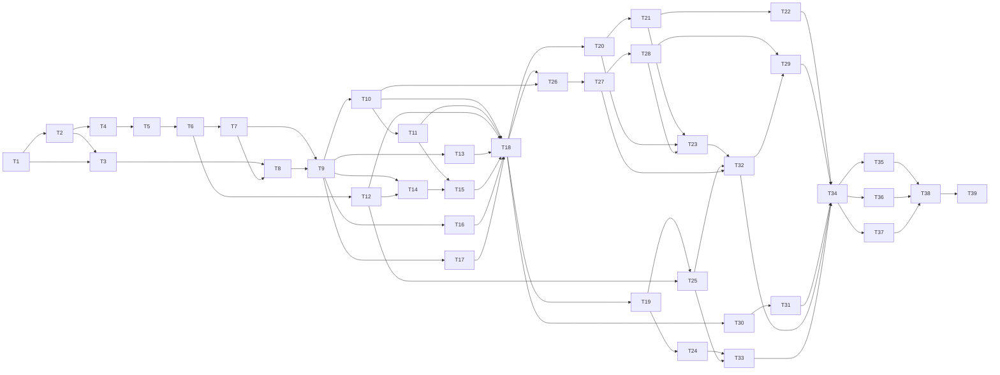

# disp-xr — Implementation Plan

Companion to [specs.md](specs.md) (the PRD). This plan turns the PRD into 39 tasks across 4 milestones. Each task is sized to fit one or a few pull requests, and each subtask fits one commit or one small PR.

## How to read this plan

- Task ids are `T<n>`; subtask ids are `T<n>.<m>`. Subtasks run in order unless they say otherwise.
- **Depends on** lists the task ids that must be done first. A task can start only when all of them are checked.
- **PRD** points to the requirement ids in the PRD (F = functional, S = Cal/Val science, C = cloud-native storage, NFR = a non-functional row, X = an "On the xarray side" bullet).
- Ported code follows [porting.md](porting.md); storage and ecosystem practices follow [references.md](references.md).
- **Done when** is the acceptance check for the whole task; reviewers use it to close the task.
- Every task except T39 (the 1.0 release) is a dependency of a later task, so there are no orphans. The table at the end lists both directions.
- Coding rules come from the repo `CLAUDE.md`: NumPyDoc docstrings with examples, type hints on public functions, fail early, ruff + black + mypy via pre-commit, pytest.

## Milestones

| Milestone | Release | Tasks | Gate to next milestone |
| --- | --- | --- | --- |
| M0 Foundation | v0.1 | T1–T8 | CI green, tests pass |
| M1 Core API | v0.2 | T9–T18 | API reviewed by users |
| M2 Analysis | v0.3 | T19–T34 | GNSS tie validated |
| M3 Release | v1.0 | T35–T39 | — |

## Dependency graph

---

## M0 Foundation (v0.1)

Goal: make the existing code safe to change. That means installable, tested, in CI, and with one clean path from a folder of granules to a stacked dataset.

### T1. Fix packaging and environment

- [ ] **T1. Fix packaging and environment** — Depends on: none · PRD: NFR Packaging, Licensing
  - Context: `pyproject.toml` declares `dynamic = ["version", "dependencies", "optional-dependencies"]`, but the `[tool.setuptools.dynamic]` sections are commented out, so `pip install` gets no dependencies. Versions also disagree: `requires-python >=3.12`, `environment.yml` pins `python > 3.13`, and mypy targets 3.11. The license is declared as `LICENSE.txt`, but the file is `LICENSE`.
  - Done when: `mamba env create -f environment.yml && pip install -e .[test]` works on a clean machine, and `python -c "import disp_xr"` succeeds. The new env has no `opera_utils`.
  - [x] T1.1 Replace the dynamic dependencies with a static `dependencies` list in `pyproject.toml`, covering xarray, rioxarray (0.23 or later, which writes the Zarr `spatial:` and `proj:` conventions), dask, numpy, scipy, pandas, zarr (3.1.6 or later; earlier versions silently drop arrays in nested groups), flox, h5netcdf, netcdf4, h5py, pyyaml, pyproj, rasterio, click, fsspec, pydantic and packaging. Do not add `opera_utils` or `verde`. Keep `version` dynamic (setuptools_scm).
  - [x] T1.2 Add optional extras: `test` (pytest, pytest-cov, pytest-xdist, cf_xarray), `docs` (mkdocs, mkdocs-material, mkdocstrings, mkdocs-jupyter), `gnss` (xvec, geopandas), `mintpy` (MintPy reader for round-trip tests only), `plot` (matplotlib), `interactive` (hvplot, datashader), `aws` (s3fs, asf_search, dem_stitcher, tile_mate), `cloud` (`virtualizarr[hdf,icechunk]>=2.4`, which brings icechunk and obstore), `eof` (xeofs). Comment each version floor. Move the heavy imports behind those extras.
  - [x] T1.3 Align Python versions: `requires-python >=3.12`, `environment.yml` `python >=3.12`, mypy `python_version = "3.12"`.
  - [x] T1.4 Fix `license = { file = "LICENSE" }` and add `license-files` so `LICENSES/opera-utils-BSD-3-Clause.txt` (added in T4.7) ships in the sdist and wheel. Point `project.urls` at the canonical repository (OPERA Cal/Val, per the PRD decision). Partly done: license and URLs fixed (URLs point to `opera-adt/disp-xr`, the live repo; the old `OPERA-Cal-Val/disp_xr_tools` URL redirects to a personal repo). `license-files` waits for T4.7. `license-files` added in T4.7 (`5ec30ea`).
  - [ ] T1.4b Name the maintainers and reviewers with the Cal/Val leads; add `CODEOWNERS` and the `maintainers` field in `pyproject.toml`; record them in the PRD open question.
  - [x] T1.5 Remove `opera_utils` from `environment.yml` (PRD decision: no opera_utils dependency). Remove `folium` and `mapclassify` unless an import needs them (grep first). Split dev tools into an `environment-dev.yml` if the list grows. Add `numbagg` to `environment.yml` (xarray uses it for faster NaN-aware reductions when present; disp-xr never imports it).
  - [x] T1.6 Smoke test: create the env from scratch, install, import, and run `pre-commit run -a`. Fix any lint failures in the existing code.
  - [x] T1.7 pixi: `[tool.pixi]` in `pyproject.toml` with environments `default`, `test`, `docs` and `dev`, tasks `test` and `check`, a committed `pixi.lock`, `.pixi` in `.gitignore`; README install section shows pixi first.

### T2. Test infrastructure and synthetic DISP fixtures

- [x] **T2. Test infrastructure and synthetic DISP fixtures** — Depends on: T1 · PRD: NFR Testing
  - Context: the repo has no `tests/`, and the README says "ADD TESTS". All later tasks test against small synthetic granules that mimic real DISP-S1 files, with a known signal so results can be checked exactly. The real product layers are listed in `disp-s1/src/disp_s1/product_info.py`: `displacement`, `short_wavelength_displacement`, `recommended_mask`, `connected_component_labels`, `temporal_coherence`, `estimated_phase_quality`, `persistent_scatterer_mask`, `shp_counts`, `water_mask`, `phase_similarity`, `timeseries_inversion_residuals`.
  - Done when: `pytest` runs and the fixtures generate in under 5 s. Characterization tests pin the current behavior of the existing public functions.
  - [x] T2.1 Create `tests/` with `conftest.py`. Add `tests/data/README.md` explaining how the fixtures are made.
  - [x] T2.2 Inspect one real DISP-S1 granule (`ncdump -h`). Record its groups (root, `/corrections`, `/identification`, `/metadata`), variable names, dtypes, `spatial_ref` and attributes in `tests/data/disp_s1_layout.md`. Also record, with h5py, each layer's HDF5 chunk shape, compression filters and dtype (expected: 256 x 256 chunks, gzip level 4 with shuffle), the `time` units, and the string datasets in `/identification` and `/metadata`. Repeat for one granule of each production version available and note any difference (float32 versus float64 displacement was seen between the 2025 and 2026 productions). Done: recorded in `tests/data/disp_s1_layout.md` from F44055 (2025 production) and F11116 (2026 production).
  - [x] T2.3 Write `tests/fixtures/make_disp.py::make_disp_stack(tmp_path, n_ministacks=2, epochs_per_ministack=5, shape=(64, 64), ...)`. It writes NetCDF files with real OPERA filenames, for example `OPERA_L3_DISP-S1_IW_F11116_VV_<start>Z_<end>Z_v1.0_<prod>Z.nc`, and the same group layout and `spatial_ref` (UTM EPSG) as T2.2. Write the fixtures with h5py using the same chunking and filters as T2.2, so virtual-store tests (T6.5b) see realistic files.
  - [x] T2.4 Inject a known truth: linear velocity plus an annual sinusoid plus one step, Gaussian noise with a fixed seed, and one ministack reference-date change. Fill the quality layers with controlled values (a low-coherence patch, a water strip, a few `timeseries_inversion_residuals` pixels at whole multiples of π). Return the truth arrays alongside the paths.
  - [x] T2.5 Add an option to write a duplicate granule with an older version and production date (for T5 deduplication).
  - [x] T2.5b Keep a registry of named fixture variants (`two_ministacks`, `with_gaps`, `duplicate`, `mixed_dtype`, `two_utm_zones`, `nisar`), so tests request a variant by name. Done for `two_ministacks`, `three_ministacks`, `with_gaps`, `duplicate`, `mixed_dtype`, `two_utm_zones`; `nisar` waits for T5.2.
  - [x] T2.6 Write characterization tests for `product.get_disp_info`, `stack.combine_disp_product`, `quality_metrics.get_stack_stat` / `get_value_percentage` and `utils.find_reference_point` (with a seeded RNG). Where [code_review.md](code_review.md) lists a bug (version filter, duplicate list, zero epoch with `start_date`), assert the correct behavior and mark the test `xfail(strict=True)` until the owning task fixes it. Refactors in T4–T7 must keep the rest green. Done: 4 strict xfails (bugs 1, 3 twice, 7) plus bug 8, found while testing (`get_disp_info` crashes on pandas 3 when versions differ). Bug 2 is not observable through the public API, so it has no test.
  - [x] T2.7 Configure doctests (`--doctest-modules` on `src/disp_xr`) and coverage (`pytest-cov`, report only, no threshold yet). Done: `pytest` collects `tests` and doctests in `src/disp_xr` (`static_layers`, `mintpy`, `download` are skipped until their tasks); `pixi run -e test cov` reports coverage.

### T3. Continuous integration

- [ ] **T3. Continuous integration** — Depends on: T1, T2 · PRD: NFR Testing, Typing
  - Context: `.github/` holds only `dependabot.yml` and `release.yml`, and there is no test workflow. pre-commit.ci is configured in `.pre-commit-config.yaml`.
  - Done when: every PR runs lint, mypy and tests on Python 3.12 and 3.13, and a failing test blocks merge.
  - [x] T3.1 Add `.github/workflows/test.yml`: set up the conda env (mamba or pixi), `pip install -e .[test]`, then `pytest --cov=disp_xr --doctest-modules`. Done with pixi (`prefix-dev/setup-pixi`, `locked: true` so a stale `pixi.lock` fails CI) instead of conda; checked with actionlint and by running the same commands locally. Not yet run on GitHub.
  - [x] T3.2 Matrix over Python 3.12 and 3.13 on ubuntu-latest. Cache the conda packages. Done: environments `test-py312`, `test-py313`, `test-py314` (3.14 added because plain `pixi install` resolves it); all pass locally.
  - [x] T3.3 Run mypy in CI (or confirm pre-commit.ci runs it). Fix existing type errors, or add narrow `# type: ignore[code]` with a TODO. Done: a `lint` job runs all pre-commit hooks, mypy included, so CI does not depend on pre-commit.ci.
  - [x] T3.3b Add a ruff banned-api rule (`TID251`) that forbids `import opera_utils` and `import verde`, so neither dependency can come back. Done; `static_layers.py` is exempt until T12.1 removes its import.
  - [ ] T3.4 Upload coverage as an artifact and add a coverage badge to the README. Partly done: the coverage XML is uploaded as an artifact and the table goes to the job summary. A badge needs an external service (for example Codecov) enabled on the GitHub repo; left for the maintainers.
  - [ ] T3.5 Turn on branch protection: CI required, one review required. Needs repo admin rights on GitHub; not done.

### T4. Package layout refactor

- [x] **T4. Package layout refactor** — Depends on: T2 · PRD: Architecture
  - Context: the target layout is the architecture diagram in the PRD. Each core module is a plain-function file; the accessor and estimators are thin wrappers over them. Existing modules: `download.py`, `io.py`, `mintpy.py`, `product.py`, `quality_metrics.py`, `stack.py`, `static_layers.py`, `utils.py`, `cli/geometry.py`, `log/`. Code ported from opera_utils lands in these modules task by task (T5–T14), following [porting.md](porting.md).
  - Done when: the new skeleton is importable, existing functions live in their new modules, the old import paths still work with a `DeprecationWarning`, and the T2 characterization tests pass.
  - [x] T4.0 Merge the upstream `timeseries_fitting` branch (`origin/timeseries_fitting`, last commit 2025-06-25) into the refactor branch first. It adds `timeseries/` (1,554 lines: design matrix, NumPy/JAX least squares, `fit_timeseries_block`, `get_predicted`, residual statistics) and `stack.rebase_disp`, which the stakeholder notebooks (for example Brisbane) already use. See [code_review.md](code_review.md). Done: merge commit `8a84a61`; `7fa765e` makes jax optional (the branch imported it unconditionally).
  - [x] T4.1 Create empty modules with module docstrings: `product.py`, `search.py`, `open.py`, `_remote.py`, `_credentials.py`, `_chunks.py`, `config.py`, `stack.py`, `quality.py`, `reference.py`, `corrections.py`, `geometry.py`, `export/` (`raster.py`, `zarr.py`, `netcdf.py`, `mintpy.py`, `multiscales.py`), `timeseries/`, `models/`, `gnss/`, `downsample/`, `residuals.py`, `plot.py`, `accessor.py`, `_history.py`, `_typing.py`. Done differently: modules are created by the task that fills them, not as empty files. This task created `quality.py`, `reference.py`, `geometry/` (a package: core helpers in `geometry/__init__.py`, the download code that needs the `aws` extra in `geometry/static.py`, so the core helpers import without it), `export/` (`raster.py`, `mintpy.py`), `search.py` and `config.py`.
  - [x] T4.2 Move the code: `quality_metrics` to `quality`, `static_layers` to `geometry`, `utils.find_reference_point` to `reference`, `utils.latlon_to_utm` / `utm_to_latlon` / `get_extent` to `geometry`, `io` write/reproject helpers to `export/raster.py`, `mintpy` to `export/mintpy.py`. Done (`053dd40`).
  - [x] T4.3 Leave shim modules at the old paths that re-export and emit `DeprecationWarning` (to be removed in T38). Done (`053dd40`); module-level `__getattr__` forwards every name, and `tests/test_deprecations.py` covers the aliases.
  - [x] T4.4 Define the public API in `disp_xr/__init__.py` with `__all__`. Import as `import disp_xr as dxr`. Done (`9a1fc31`): `__version__`, `get_disp_info`, `combine_disp_product`, `config`; later tasks add their functions.
  - [x] T4.5 Turn `download.py` into the ported search module `search.py` (PRD F16): add the attribution header, name the logger `disp_xr`, make the CMR short name an argument (default DISP-S1; `ProductSpec` supplies it from T5.2 on), and fix the dropped frame filter when `product_version=None` (porting.md, upstream bug 2). Port the mocked-request tests from `test_disp_search.py`. Leave `download.py` as a shim with a `DeprecationWarning` (removed in T38). Check the PRD download open question. Done: `3c432ff` (rename), `19a84e5` (session and short name), `5bd79cf` (frame-filter fix, bug 9). Follow-up: `search` takes `short_name` directly; let it accept a `ProductSpec` once T6 needs NISAR search.
  - [x] T4.6 Replace the empty `cli/geometry.py` group with a `cli/__init__.py` exposing `cli_app`, so the `disp_xr.cli:cli_app` entry point resolves. Commands come in T15. Done (`cf9eaaf`).
  - [x] T4.7 Attribution for ported code: add `LICENSES/opera-utils-BSD-3-Clause.txt`, a `THIRD_PARTY_NOTICES.md` that lists each ported function with its source path and commit `dff4b45`, and the header template from [porting.md](porting.md). Every later task that ports a function adds the header and a row to the notices file. Done (`5ec30ea`): `LICENSES/opera-utils-BSD-3-Clause.txt` ships in the wheel; the existing copies in `search.py` and `stack.py` have headers but no recorded source commit.
  - [x] T4.8 Re-scoped: `get_template` / `get_counts` are still used by `get_value_percentage`, and `get_chunks_indices` by the MintPy writer, so they are deleted where their callers are replaced (T10.3 and T14.3). `get_extent` stays in `geometry` until T6.2 replaces it with `ds.rio.bounds()`.
  - [x] T4.9 Add `disp_xr.config` (PRD API rules): one settings object for default chunk byte target, `max_load_bytes`, thread counts and quality thresholds, with `DISP_XR_*` environment overrides. Use `donfig`, which zarr already depends on. Test the env override. Done (`d7ee2e2`); `donfig` is a declared dependency.

### T5. Product discovery and product spec registry

- [x] **T5. Product discovery and product spec registry** — Depends on: T4 · PRD: F1, NFR Compatibility
  - Context: `product.get_disp_info` hand-parses filenames and has a broken version filter and duplicate list (bugs 1–2 in [code_review.md](code_review.md)). The parser and deduplication are ported from opera_utils `DispProduct` / `DispProductStack` into `product.py` (see [porting.md](porting.md)), and disp-xr owns and tests them. DISP-S1 and DISP-NISAR must both be supported at 1.0, so product differences (filename regex, CMR short name, layer names, units, corrections, wavelength, geometry source) live in one `ProductSpec` registry. The NISAR layout reference is `00_tools/src/disp-nisar/src/disp_nisar/product_info.py`.
  - Done when: `dxr.find_products(path)` returns a typed DataFrame for S1 fixtures. Duplicates resolve to the latest version and production date, and a NISAR spec entry exists (validated fully in T35).
  - [x] T5.1 Add a frozen `ProductSpec` dataclass: filename regex, CMR short name, layer names, corrections group and layers with a `pre_applied` flag, units, wavelength and orbit height, static-geometry source, supported product versions, and where the reference time lives. Done (`516276e`).
  - [x] T5.2 Register `DISP_S1` from T2.2. Inspect one real or sample DISP-NISAR granule and register `DISP_NISAR` from it and `disp_nisar/product_info.py`; mark `ionospheric_delay` as pre-applied and the spec as `validated=False` until the full suite passes in T35. Done, provisionally: no official DISP-NISAR granule exists on disk. The pre-release SAS outputs (v0.4) are named `<ref>_<sec>.nc` and still carry Sentinel-1 placeholders in `/identification`, so they are identified from metadata and the NISAR filename pattern is a guess. `DISP_NISAR.validated` stays False; NISAR `ionospheric_delay` is marked pre-applied.
  - [x] T5.3 Port the filename parser into `product.py` as a frozen `DispGranule` dataclass. Implement `find_products(path_or_paths, min_version=None) -> pd.DataFrame`: one row per granule plus `path`, with typed datetimes, sorted by secondary time. `min_version` filters with `packaging.version`, not string comparison. Done; also reads frame, dates and version from `/identification` when the name is not an OPERA name.
  - [x] T5.4 Port the deduplication (latest version, then latest generation time), comparing versions with `packaging.version` (porting.md, upstream bug 1). Expose the dropped products as `df.attrs["dropped"]` and log them. Keep `get_disp_info` as a deprecated shim that returns the old column names (the notebooks use them). Done (`49634aa`), but `get_disp_info` is not deprecated yet: `combine_disp_product` still needs its columns, so deprecation moves to T7, when the stack takes `find_products` output.
  - [x] T5.5 Implement `group_ministacks(df)`, which returns ordered groups by reference date (replacing `_get_reference_dates` and `_find_duplicates`). Also group by production version, because granules of different productions can differ in dtype and encoding. Done; production grouping is handled by `check_granules` (T5.8).
  - [x] T5.6 Add tests: S1 fixtures, the duplicate fixture, mixed frames (raises unless `frame_id` is given), an unknown filename (raises a clear error). Port the filename and dedupe tests from opera_utils `test_disp_product.py`, and add a `1.10` versus `1.9` version test. Done; checked on real data too: F44055 (209 granules, 14 ministacks), Brisbane F39355 v0.10 (248, 17), DISP-NISAR golden (5).
  - [x] T5.7 Version support (PRD NFR Compatibility): `open_disp` and `find_products` raise `UnsupportedProductVersionError`, naming the version and the supported range, for a product version that is not in `ProductSpec.supported_versions`. Parameterize the fixtures over each released version. Done for the version check (DISP-S1 `>=0.10,<2`, DISP-NISAR `>=0.4,<2`, from versions seen on disk); fixtures cover 0.9 (dropped duplicate), 0.10, 1.0, 1.9 and 1.10 by name.
  - [x] T5.8 Add `check_granules(df)`: read dtype, chunk shape and filters per layer with h5py, and report groups of granules that differ. `open_disp` and the virtual path (T6.5b) refuse a mixed set with `MixedProductionError`, which names the groups and their production dates so the caller can select one (PRD decision: refuse, do not cast). Test with the `mixed_dtype` fixture. Done (`b4ba55b`). Opens every file: 20 to 30 s for 200 to 250 granules on the network filesystem; parallelize when `open_disp` calls it (T6).

### T6. `open_disp` for local paths and S3

- [x] **T6. `open_disp` for local paths and S3** — Depends on: T5 · PRD: F2, C3, NFR Performance, Scale, X (DataTree)
  - Context: `stack.combine_disp_product` calls `xr.open_mfdataset` once per ministack with default chunks `{"time": -1, "x": 512, "y": 512}`. Opening a full frame must read metadata only, with no pixel reads. Remote access and Earthdata credentials are ported from opera_utils `_remote.py` and `credentials.py` ([porting.md](porting.md)).
  - Done when: `dxr.open_disp(path | list | glob | "s3://...")` returns a lazy `xr.Dataset` (time, y, x) with CRS, `time`, `reference_time` and the requested layers. A test proves no chunk is computed during open.
  - [x] T6.1 Implement a `preprocess` hook that adds `time` (secondary datetime) and `reference_time` coordinates from the filename row, and drops unneeded variables early (`layers=` argument). Open with the settings `combine="nested"`, `concat_dim="time"`, `data_vars="all"`, `coords="minimal"`, `compat="override"`, `join="exact"`: the 2D layers have no time dimension in the file, and a granule on a different grid must raise, not be padded. Call `check_granules` on open; it takes about 0.1 s per granule serially, so run it in a thread pool. Done (`c01c5dc`). Measured on a real 209-granule frame: granules are read in 1024-pixel blocks (`config['chunks.read_block']`) and rechunked, so the open takes about 20 s (37 s with corrections) instead of 87 s, and a one-pixel series reads in 6 s. Integer layers keep their dtype (`mask_and_scale=False`).
  - [x] T6.2 Attach the CRS with `rioxarray` from `spatial_ref` and set `x` / `y` as spatial dims. Verify `ds.rio.crs` and `ds.rio.transform()`. Open with `decode_coords="all"` so `spatial_ref` comes back as a coordinate, and make sure every data variable keeps `grid_mapping` whether xarray put it in `attrs` or `encoding`. Replace `geometry.get_extent` with `ds.rio.bounds()` and keep a deprecated alias (moved from T4.8). Done; `get_extent` is deprecated with a pointer to `ds.rio.bounds()` (`684355c`), whose return order differs, so it is not a drop-in replacement.
  - [x] T6.3 Open the `/corrections` group lazily on request (`corrections=True`) and merge it on the same grid. Done.
  - [x] T6.4 Remote support (S3 and HTTPS): port `open_file`, `open_h5` and the filesystem helpers into `_remote.py`, and the Earthdata login and temporary S3 credentials into `_credentials.py`, with attribution. Keep `cache_type="first"` and the 4 MiB HDF5 page size. Expose a refreshable `get_credentials` callable (credentials expire after about 1 hour). `find_products` accepts an `s3://` or `https://` prefix and lists granules with fsspec. Port `test_disp_remote.py` and `test_credentials.py` with monkeypatched filesystems. Done (`735bf49`): `_remote.py` and `_credentials.py` ported; any fsspec URL works, which the tests use (`memory://`).
  - [x] T6.4b Offer `open_disp_tree(path)` returning an `xr.DataTree` with the product groups as nodes (PRD X: DataTree). `/corrections` opens through xarray; `/identification` and `/metadata` are read with h5py into attributes, because xarray cannot decode their byte strings. Done (`075795a`).
  - [x] T6.5 Make chunking configurable through `_chunks.py`: `suggest_chunks(shape, dtype, layout="timeseries" | "maps", target_mb=100)` computes the spatial chunk from the byte target (256 x 256 for a 300-epoch float32 stack), and `chunks=` accepts a preset name or a dict. Port `_clamp_chunk_dict`. Warn when the user chunks over time, and rechunk after an AOI clip so clipped stacks do not keep ragged chunks. Done (`a3e78c0`): presets sized from the byte target and aligned to the 256-pixel file chunks; rechunking after an AOI clip is left to the clip function (T9 or later).
  - [x] T6.6 Add tests: an open-and-inspect test that asserts the dask graph has no compute (a scheduler counter or a `dask.config` callback); layer selection; corrections merge; S3 mocked with `moto` or a local fsspec memory filesystem. Mark cloud tests with `pytest.importorskip` so the core CI runs without the `cloud` extra, and add one CI job that installs it. Done: the laziness test installs a dask scheduler that fails if called; the remote test uses fsspec's memory filesystem.
  - [x] T6.7 Chunking per operation (added 2026-10-02, after a full-frame quick-look did not finish in 15 minutes). `open_disp` defaults to a new `"native"` preset, the file layout (one epoch, one `chunks.read_block` block per chunk), so a selection reads only the epochs and blocks it needs. `stack_disp` chains with 2D selections and sums (`_chain_lazy`) instead of an `apply_ufunc` over a whole-time chunk, and keeps the input chunks, so one chained epoch reads itself and one crossover per earlier ministack (test: 2 source epochs for the last epoch of two ministacks). Per-pixel functions rechunk for themselves (`time_contiguous`); `fit_timeseries_block` now does, which fixes wrong fits on time-split chunks, and drops non-dimension coordinates so it runs on `open_disp` output. `dxr.rechunk` / `.disp.rechunk` switch presets explicitly. Plots and exports run with at most `config["num_workers"]` (32) dask threads: dask's one-per-core default (224 on Aurora) exceeded `vm.max_map_count` while reading a pixel series. Measured on F44055 (209 granules, 7721 x 9462): open 17 to 25 s; full-frame map of the last chained epoch 38 to 73 s; 90 m point series 16 to 32 s (network filesystem cache varies), where before the map did not finish and the point series crashed.

### T7. Ministack chaining

- [x] **T7. Ministack chaining** — Depends on: T6 · PRD: F3
  - Context: displacement in each ministack is relative to that ministack's reference date. The chaining kernel and `NaNPolicy` are ported from opera_utils `_rebase.py`, and the lazy wrapper is reimplemented on `xr.apply_ufunc` ([porting.md](porting.md)). The `timeseries_fitting` branch merged in T4.0 holds unattributed copies (`create_rebased_displacement`, `rebase_timeseries`, `rebase_disp`); this task keeps one implementation. The current `stack.combine_disp_product` also builds the zero first epoch wrongly when `start_date` is set (bug 3 in [code_review.md](code_review.md)).
  - Done when: `dxr.stack_disp(...)` (or `open_disp(..., chain=True)`) returns one cumulative series from the first epoch that matches the T2 truth exactly (up to float tolerance) across one or more reference changes. Masked pixels propagate as NaN.
  - [x] T7.1 Write the math in the docstring: cumulative(t) = disp_k(t) + cumulative(ref_k) for t in ministack k. Done: module docstring of `stack.py`.
  - [x] T7.2 Port `rebase_timeseries` as a private kernel that keeps the input dtype and checks that each crossover epoch exists. Wrap it with `xr.apply_ufunc(dask="parallelized", input_core_dims=[["time"]])`, reading reference times from `ds.reference_time`. Apply it to displacement and `short_wavelength_displacement` only; quality layers stay per epoch. Delete `rebase_disp` and the duplicate copies from the branch. Done (`bb82459`), with one change from the port: the offset comes from the epoch whose date is the new reference date, not the previous epoch, and a missing crossover raises `MissingCrossoverError`. `rebase_disp`, `create_rebased_displacement` and `combine_disp_product` are deprecated wrappers (removed in T38); the unattributed copies are gone.
  - [x] T7.3 Prepend the zero epoch for displacement layers only, dated at the first reference time of the selected ministacks (not of all products), with `reference_time` equal to that time. Done; other layers get their no-data value at the zero epoch, so integer masks stay integer.
  - [x] T7.4 Support `start` and `end` filtering at the ministack level, refusing to start mid-ministack unless re-referenced to that epoch (documented). Done: `start` must be a ministack reference date (otherwise `ValueError` listing them); `end` drops later epochs.
  - [x] T7.5 Port `NaNPolicy` (`propagate` default, `omit`) as a public enum, with a docstring explaining when each applies; test both. Done.
  - [x] T7.6 Port the tests from opera_utils `test_disp_rebase.py`, add tests with 1, 2 and 3 reference changes against the T2 truth and a test that the zero epoch has a unique time label (porting.md, upstream bug 3), and update the T2.6 characterization test on purpose. Done: kernel cases ported with explicit secondary dates, truth tests for 2 and 3 ministacks, unique zero-epoch time, bug 3 regression tests. Checked on real F44055: 210 epochs, zero mismatch against manual chaining.

### T8. Release v0.1

- [ ] **T8. Release v0.1** — Depends on: T3, T7 · PRD: Milestones (M0 gate)
  - Context: gate "CI green, tests pass". This first tagged release lets early users install the package.
  - Done when: tag `v0.1.0` exists, CI is green on the tag, and a short changelog is published.
  - [x] T8.1 Add `CHANGELOG.md` (Keep a Changelog format) and fill in v0.1.0. Done on `chore/release-v0.1` (`c3b5763`); dated when tagged.
  - [ ] T8.2 Configure `.github/release.yml` categories and tag `v0.1.0` (setuptools_scm picks it up). `release.yml` done (T18 preparation). Waiting: the tag, on `1c04c1c` (the last `main` commit of M0, before T9), pushed by a maintainer.
  - [x] T8.3 Update the README quick start to `dxr.find_products`, `dxr.open_disp` and chaining. Done (`c3b5763`); the snippet was run on a fixture stack.
  - [ ] T8.4 Set target dates for M1–M3 with the maintainers (PRD open question) and record them in the PRD. Waiting: needs the maintainers (T1.4b).

---

## M1 Core API (v0.2)

Goal: the everyday DISP workflow (open, mask, re-reference, correct, export, plot) as functions plus a chainable `.disp` accessor, documented.

### T9. Accessor and history skeleton

- [x] **T9. Accessor and history skeleton** — Depends on: T7, T8 · PRD: API design principles
  - Context: the accessor follows rioxarray `.rio`. API rules: never mutate inputs, record operations in `attrs["history"]`, stay lazy, keep coordinates and CRS, and use meters internally.
  - Done when: `ds.disp` exists on Dataset and DataArray. A no-op operation round-trips with history recorded, CRS kept and no compute.
  - [x] T9.1 Settle the accessor name (PRD open question). Check for clashes with installed accessors; default `.disp`. Record the decision in the PRD and check the open question. Done: `.disp`; no installed accessor uses the name, and a test fails if registering it ever triggers xarray's override warning. Recorded in the PRD.
  - [x] T9.2 Implement `register_dataset_accessor` / `register_dataarray_accessor` classes that delegate to module functions. No logic lives in the accessor. Done (`a305a7c`): `stack`, `to_units`, `validate`, `history`, `grid`; methods for later tasks are added with them.
  - [x] T9.3 Write `_history.record(obj, op_name, **params)`, which appends a JSON line with disp-xr version, op and params to `attrs["history"]`. Wire it as a decorator for public ops. Keep `long_name`, `units` and `grid_mapping` on every result (PRD API rules: CF metadata). Follow the xclim pattern: public ops are plain functions wrapped by one decorator that checks units, sets the CF attributes and appends history. Done (`0f6adb7`): JSON lines without timestamps, so outputs stay reproducible; `open_disp`, `stack_disp` and `to_units` are recorded. CF attributes are kept by each operation.
  - [x] T9.4 Add a units helper: read `units` attrs, convert to meters on open, and `to_units("mm")` for output. Done (`f161a40`): `to_units` for m, cm, mm; DISP already stores meters, so nothing is converted on open.
  - [x] T9.5 Add `validate_disp(ds)`, which checks the required dims, coords and CRS and raises a clear error. Call it at the start of each op. Validate by component, as xarray-schema does: dims, dtype, CRS and chunks (warn when `time` is split across chunks before a per-pixel op). Keep grid and CRS access behind one helper in `geometry.py`, so a raster index (rasterix, xproj) can replace it later. Done (`b862cc0`), plus `geometry.grid` as the single grid/CRS reader.
  - [x] T9.6 Add tests: immutability (input unchanged), history content, CRS kept, laziness. Done: immutability, history, CRS, laziness (a scheduler that fails if called) and equivalence with the module functions.

### T10. Quality layers and masking

- [x] **T10. Quality layers and masking** — Depends on: T9 · PRD: F4
  - Context: `quality.py` holds `get_stack_stat` and `get_value_percentage`, rewritten lazily (`get_counts` and `get_template` were deleted in T4.8), and the mask helpers ported from opera_utils `combine_quality_masks` and `create_reliability_mask` ([porting.md](porting.md)). Masking uses `recommended_mask`, `temporal_coherence`, `connected_component_labels` (0 = unwrapping failed) and `water_mask`. Some layers are per epoch, others per ministack. In the fixed processing order, masking runs per product before chaining, so it must work on unchained data.
  - Done when: `dxr.mask(ds, "recommended")` and `dxr.mask(ds, temporal_coherence=0.6, connected_components=True, water=True)` return masked displacement. Tests check the exact pixels removed in fixtures.
  - [x] T10.1 Port `combine_quality_masks` and implement `mask(ds, preset=None, **thresholds)` on it, with presets `"recommended"` (product mask only) and `"strict"` (recommended + coherence + connected components + water). Port the upstream mask tests. Done differently: `combine_quality_masks` is ported as-is (strict `>`, any reduction), but `mask` builds on `valid_mask`, which uses `>=` thresholds, AND-reduces, and fails integer no-data pixels; the default preset is `"recommended"`.
  - [x] T10.2 Handle per-epoch versus static layers by broadcasting on `time` correctly. Document which layers are which. All 11 layers are per epoch in both products, so no broadcasting is needed; the zero epoch prepended by `stack_disp` stays unmasked.
  - [x] T10.3 Add `quality_summary(ds)`, which returns per-pixel percentages (time masked, PS fraction), the harmonic-mean temporal coherence and the reliability fraction (ported `create_reliability_mask`) as a lazy `xr.Dataset`. Per-ministack summaries use `groupby("reference_time")` through flox, with no Python loop (PRD X: flox). Percentages divide by the valid-epoch count. Delete `get_template` and `get_counts` here (moved from T4.8).
  - [x] T10.4 Add accessor wiring, history and tests (fixture low-coherence patch and water strip removed exactly).

### T11. Re-referencing

- [x] **T11. Re-referencing** — Depends on: T10 · PRD: F5
  - Context: the per-epoch reference methods none, point, median, border and high_coherence are ported from opera_utils `get_reference_values` into `reference.py` ([porting.md](porting.md)). disp-xr adds area polygons and a deterministic `"auto"` pick. The old `find_reference_point` uses `random.choice` (bug 7). Re-referencing subtracts the reference value at every epoch.
  - Done when: re-referencing to a point (lon/lat or y/x), an area median (bbox or polygon) or `"auto"` works lazily. Auto is deterministic, and fixture tests show the reference pixel is exactly zero.
  - [x] T11.1 Port `ReferenceMethod` and `get_reference_values`, and implement `rereference(ds, method="point" | "median" | "border" | "high_coherence" | "area" | "auto", ...)` on them. Fix the upstream gaps (porting.md, bug 5): bounds-check the point, make the median honor the good-pixel mask, and require a mask for high_coherence. Convert lon/lat with `pyproj` and `ds.rio.transform()`, and raise `OutOfBoundsError` if the point is outside the frame or masked. Port `test_disp_reference.py`.
  - [x] T11.2 Implement area mode: `rereference(ds, bbox=...)` or `geometry=...` (shapely), using the weighted median of valid pixels per epoch. Done unweighted: the median of pixels inside the area and `good_pixels`; quality weights arrive with T26.
  - [x] T11.3 Implement `"auto"`: a deterministic pick by center of mass of the high-quality candidates (ported from opera_utils `find_reference_point`), scored on PS fraction, harmonic-mean coherence and zero phase jumps. Return the chosen point in attrs. Done as `find_stable_point`: candidates are never masked and have no residual of half pi or more; the coherence threshold steps down from 0.95; PS candidates are preferred. The legacy `find_reference_point` keeps its signature and now uses the same center-of-mass pick.
  - [x] T11.4 Add accessor wiring, history and tests (point, area, auto, masked-point error).

### T12. Geometry and static layers

- [ ] **T12. Geometry and static layers** — Depends on: T6 · PRD: F7
  - Context: `geometry.py` holds the moved `get_static_layers`, `los_unit2inc_azimuth`, `download_dem` and `download_water_mask`. `get_static_layers` calls `opera_utils.geometry.stitch_geometry_layers`, the only live opera_utils import in the repo. CSLC-STATIC bursts exist for Sentinel-1 only; DISP-NISAR uses DISP-NI-STATIC. GNSS projection (T25) needs LOS unit vectors on the DISP grid.
  - Done when: `dxr.open_static(ds_or_frame_id)` returns LOS east/north/up, incidence, azimuth, DEM and water mask aligned to the DISP grid, and `enu_to_los(e, n, u, los)` is tested. `grep -r "import opera_utils\|from opera_utils" src/` returns nothing.
  - [x] T12.1 Refactor `get_static_layers` to return an `xr.Dataset` on the DISP grid (`rio.reproject_match` where needed). Replace the `opera_utils` stitcher with a rioxarray merge of the CSLC-STATIC bursts (layer names and nodata values from [porting.md](porting.md)), and remove the import. Done: `open_static` reads the frame-level DISP-S1-STATIC product (LOS ENU, DEM, layover/shadow on the DISP grid, recorded in `tests/data/disp_s1_layout.md`); `stitch_cslc_static` is the fallback for frames without it. `open_static` takes a dataset; a bare frame id is not supported.
  - [x] T12.2 Add `enu_to_los(east, north, up, los_ds)` and the inverse helper for incidence and azimuth. Pin the sign convention in the docstring (positive LOS toward the satellite, per the product spec).
  - [x] T12.3 Make DEM and water-mask downloads optional (`aws` extra) and cache them on disk. Done: DISP-S1-STATIC files are cached under `config["cache.dir"]`; the DEM comes from them and the water mask from the granules, so `download_dem` and `download_water_mask` are deprecated (imports now lazy).
  - [x] T12.4 Add tests with a synthetic LOS geometry, including the projection of a pure-up motion.
  - [ ] T12.5 NISAR geometry source: LOS vectors, incidence and DEM for DISP-NISAR frames from DISP-NI-STATIC, selected through `ProductSpec.static_source`. Add slant range from incidence with the wavelength and orbit height of the spec. Open: `geometry.los.slant_range` is done; no DISP-NI-STATIC collection exists in CMR (checked 2026-10-02), so reading it waits for a real granule.

### T13. Corrections

- [x] **T13. Corrections** — Depends on: T9 · PRD: F6, F15
  - Context: DISP granules ship correction layers in the `/corrections` group (opened in T6.3). Which layers exist must be checked on a real granule (T2.2), not assumed. Troposphere may come from an external product, so the API accepts a user DataArray. DISP-NISAR displacement already has the ionospheric delay applied, so the spec marks that layer `pre_applied` and `correct` refuses it.
  - Done when: `dxr.correct(ds, ["ionosphere", "solid_earth_tide"])` subtracts the layers present in the product, a user-supplied troposphere DataArray can be subtracted after grid and time alignment, and missing layers raise a clear error.
  - [x] T13.1 List the correction layers per spec in `ProductSpec` (from T2.2 and the NISAR spec).
  - [x] T13.2 Implement `correct(ds, which, external=None)`, with grid alignment for external layers by `reproject_match` and time alignment by exact match or a documented interpolation. Done with exact date match only (missing dates raise); `external_kind="absolute"` turns per-date values into differences against each epoch's reference date. `correct` refuses chained data, since the layers are relative to each granule's reference.
  - [x] T13.3 Record applied corrections in history and in a `corrections_applied` attr so a correction is never applied twice. Refuse a layer the spec marks `pre_applied`, with a clear message.
  - [x] T13.4 Add accessor wiring and tests.
  - [x] T13.5 Plate motion (PRD F15): `plate_motion_los(static, plate)` computes rigid plate velocity from the ITRF2014 plate motion model (Altamimi et al. 2017) and projects it to LOS with T12. Implement it from the paper, not from opera_utils or MintPy code (GPL lineage, see [porting.md](porting.md)). Test `geodetic_to_ecef` against pyproj and one plate velocity against a published value. Done, plus `remove_plate_motion(ds, static, plate)`, which works before or after chaining. The origin rate bias is not added.

### T14. Export

- [x] **T14. Export** — Depends on: T9, T12 · PRD: F12, C1, C2, NFR Provenance, Metadata
  - Context: `export/raster.py` holds the moved GeoTIFF writer and reprojection, and `export/mintpy.py` starts from the old MintPy writer, which is replaced by a port of opera_utils `disp_nc_to_mintpy` ([porting.md](porting.md)). Zarr and NetCDF encodings are also ported from opera_utils. Every output must record the disp-xr version, input granules and operations (history). Storage rules are in the PRD ("Storage rules") and [references.md](references.md).
  - Done when: `to_geotiff`, `to_zarr`, `to_netcdf` and `to_mintpy` round-trip fixtures (read back and compare) with provenance attrs present.
  - [x] T14.1 `to_geotiff(da, path)` for a 2D layer as a COG with overviews, and `per_epoch=True` for one COG per epoch, using `rio.to_raster`.
  - [x] T14.2 `to_zarr` (PRD C1, storage rules) in `export/zarr.py`: call `drop_encoding()` first, then build the encoding explicitly (`chunks`, `shards`, `compressors` per variable). Zarr v3 with spec-defined codecs only (zstd level 3 by default). Presets `chunks="timeseries"` and `"maps"`: the shard equals one dask chunk from `suggest_chunks` (T6.5), and the read chunk inside it is 5 to 20 MB (64 x 64 over all of time, or 1,024 x 1,024 of one epoch). One chunk grid for all variables, shards a whole multiple of chunks with a divisibility check, dask chunks aligned to the shard shape before writing (never `safe_chunks=False`), coordinates as single uncompressed chunks, and any zarr `Store` or URL accepted. Write consolidated metadata for plain stores but do not require it on read. Port `_get_zarr_encoding` and `_get_netcdf_encoding`; `to_netcdf` uses the latter. Port `round_mantissa` as an opt-in `keep_bits=` (default off, so Cal/Val outputs stay exact). Done in `export/zarr.py`: maps shards round to a whole number of 1,024 chunks (for example 4,864 to 5,120).
  - [x] T14.2a Metadata on write (PRD NFR Metadata): `spatial_ref` with `crs_wkt` and `GeoTransform`, `grid_mapping` on every data variable, `flag_values` / `flag_meanings` on mask and label layers, and the Zarr `spatial:` and `proj:` attributes written through rioxarray 0.23 (fall back to an own writer from `ds.rio.transform()` and `ds.rio.crs` if it does not cover a case). Set the Zarr `fill_value` explicitly: NaN for floats, the product nodata for integer masks. Test that both `_FillValue` and `fill_value`, the mask dtypes, the CRS and the transform survive a round trip, and that the output decodes with cf_xarray. Done: rioxarray 0.23 has the Zarr convention reader but its writer only declares `proj:`, so disp-xr writes `proj:` and `spatial:` with rioxarray's helpers.
  - [x] T14.2b `to_icechunk(ds, repo, branch="main", message=..., append_dim=None, tag=None)` (`cloud` extra, PRD C2): a thin wrapper over `icechunk.xarray.to_icechunk` (never `ds.to_zarr` on a session store, which loses distributed writes). Check that the grid matches before an append along `time`. Put provenance (disp-xr version, product version, frame, input granules, operations) in commit metadata, set before the session opens. Return the snapshot id and store it in the provenance of downstream outputs; `tag=` tags a Cal/Val run. Add `open_icechunk(repo, branch | tag | snapshot_id)` on a read-only session with `consolidated=False`. Never amend a commit and never expire snapshots from library code. Test against in-memory storage: round trip, append, tag lookup, snapshot id. An append store uses a fixed time chunk of one ministack, with time shards a whole multiple of it; the `timeseries` preset is refused for appends because every shard would be rewritten. Done in `export/icechunk.py`, with a pixi `cloud` feature and a `test-cloud` CI job. The append layout is a new `"ministack"` chunk preset: time chunk and shard are the first write's epochs, and the read chunk is about 16 MB (15 epochs of a frame: 512 x 512 for float32, 256 x 256 for float64). An append to an empty branch creates the store; later appends must match variables, `x`/`y`, CRS and dtypes and start after the last epoch, and are rechunked to the stored shards. Provenance is passed to `commit(metadata=...)` rather than set as default commit metadata, so the caller's `Repository` is not modified; the wrapper makes its single commit itself. A missing branch is created from `main`. `open_icechunk` records `source_snapshot_id`, which later exports keep.
  - [x] T14.2c (Moved from T6.5b; it needs the Icechunk writer above.) Optional virtual open (`cloud` extra, PRD C3), in `virtual.py`: `build_virtual_frame(granules, repo)` opens each granule with VirtualiZarr `HDFParser` in processes (the parser holds the HDF5 lock, so threads do not help), with `time`, `reference_time`, `x`, `y` and `spatial_ref` loaded and the `/identification` and `/metadata` strings dropped. It refuses granule sets that fail `check_granules` (T5.8), concatenates along time with the T6.1 settings, writes to Icechunk one ministack per commit, and registers a virtual chunk container for the source bucket with credentials passed at open. Add `validate_virtual(repo, granules, n_samples)`, which compares random pixel series and one full epoch against h5py reads. Test on fixtures with a local Icechunk store. Done in `virtual.py`: `build_virtual_frame`, `open_virtual`, `validate_virtual`, exported from `disp_xr`. Granules are parsed in a spawn process pool (`max_workers=1` parses in-process). A path or `icechunk.Storage` gets a container for the granule directory or `s3://` bucket, saved in the repo config; a `Repository` passed in must already have one. A branch that holds a frame is extended with the `to_icechunk` append checks. `validate_virtual` also reports references that no longer decode (a granule rewritten after the build moves its chunks). Not done: the `/corrections` group as a separate node (references.md, opt-in); the S3 path (bucket container, ASF credentials) is written but not run against S3; credentials are static, so a build longer than the ASF token lifetime (about 1 hour) needs refreshable credentials.
  - [x] T14.3 MintPy export (`mintpy` extra): port `disp_nc_to_mintpy` and its helpers into `export/mintpy.py`, adapted to take an `xr.Dataset`, with platform, wavelength and orbit height from `ProductSpec` (the upstream writer hard-codes Sentinel-1). Write `timeseries.h5` and `geometryGeo.h5` with h5py chunk by chunk, with compression on every dataset and no threads. Keep the old `get_metadata` key mapping as the reference and check the output once against the old `mintpy.py` on one frame. Delete `utils.get_chunks_indices` with the old writer (moved from T4.8). Done as `to_mintpy(ds, outdir, static=...)`: only h5py is needed to write; MintPy's `readfile` reads the output (test in the `dev` env); azimuth converted to MintPy's anticlockwise convention; `velocity.h5` is not written (fits belong to the time-series module, T19). Not done: the one-frame comparison with the old writer, which needs the deleted code and a dask cluster.
  - [x] T14.4 Add a provenance writer that adds `disp_xr_version`, the versions of xarray, zarr and dask, `input_granules` and `history` to every output. Done in `export/_provenance.py`; `open_disp` now records granule names in `attrs["input_granules"]`.
  - [x] T14.5 Add round-trip tests for each format, and a MintPy test that reads the output back with h5py and checks datasets and attrs.

### T15. Command-line interface

- [x] **T15. Command-line interface** — Depends on: T11, T14 · PRD: F14
  - Context: the `disp_xr` entry point already points to `disp_xr.cli:cli_app` (click). The CLI covers batch runs and export. It wraps library functions and contains no logic.
  - Done when: `disp_xr info`, `disp_xr stack` and `disp_xr export` work on fixtures and are covered by `click.testing.CliRunner` tests.
  - [x] T15.1 `disp_xr info PATH`: product table summary (frames, dates, versions, duplicates). Done; `--json` and `--table granules.csv`.
  - [x] T15.2 `disp_xr stack PATH --mask strict --reference auto --out out.zarr`: open, apply corrections, mask, chain, re-reference, write, in the fixed processing order of the PRD. Done; output format from the suffix (`.zarr`, `.nc`); `--corrections product` (default) skips corrections the product already applied (DISP-NISAR ionosphere). `stack_disp(start=)` now accepts a plain date for a reference time with a time of day.
  - [x] T15.3 `disp_xr export PATH --format geotiff|zarr|netcdf|mintpy`. Done; PATH is a store from `stack` or granules (chained only).
  - [x] T15.4 `disp_xr geometry PATH --out static.zarr`: a new command that wraps `dxr.open_static` (the old `cli/geometry.py` had no commands and was replaced in T4.6).
  - [x] T15.4b `disp_xr search --frame F --start ... --end ...`: wraps `dxr.search` (PRD F16) and prints or saves the granule table. Done as `--frame-id`; `search` is `disp_xr.search.search` (not in the top-level namespace).
  - [x] T15.5 Add CLI tests and `--help` text checks. Done (`tests/test_cli.py`). Also added `disp_xr virtual` (T14.2c). Fixed on the way: `log-config.json` named `JsonFormatter` for the `JSONFormatter` class, so `setup_logging`, and with it every CLI command, always failed.

### T16. Documentation site

- [ ] **T16. Documentation site** — Depends on: T9 · PRD: NFR Docs
  - Context: the target is mkdocs on GitHub Pages (changed from ReadTheDocs on 2026-10-04), with an API reference from type hints and a short gallery of worked examples in the style of verde. Existing notebooks: `notebooks/workflow.ipynb`, `interactive_workflow.ipynb`, `validation/Compare_disp_versions.ipynb`.
  - Done when: the docs build in CI and publish on GitHub Pages with getting started, API reference and at least 3 gallery examples. Later tasks add one example each.
  - [x] T16.1 Add `mkdocs.yml` with material, mkdocstrings (numpy style) and mkdocs-jupyter, plus `.readthedocs.yaml`. Done; the pixi `docs` feature now has matplotlib and ipykernel, and mkdocs-material 9.7.
  - [x] T16.2 Write the pages: install, getting started (open, mask, re-reference, plot), concepts (ministacks, reference dates, units, quality layers). Done, plus command line, chunks in concepts, and an API reference grouped by task; the getting-started code was run as written.
  - [x] T16.3 Write gallery examples as short executed notebooks under `docs/gallery/`, using fixture data or a small public subset. Done as `# %%` scripts executed by mkdocs-jupyter: quick look, quality masks, export, chunks. The synthetic-granule writer moved from `tests/fixtures/make_disp.py` into the package as `disp_xr.tutorial`, so the gallery runs anywhere.
  - [x] T16.4 Add a CI job that builds the docs with `--strict` (broken references fail). Done; it also executes the gallery.
  - [x] T16.5 Link `specs.md` and `todo.md` from a "Development" section. Done with the index, code review, porting and references pages too. Not done: publishing on ReadTheDocs, which needs the project connected on readthedocs.org (a private repository needs a ReadTheDocs for Business account, or a public one).
  - [ ] T16.6 Publish on GitHub Pages. Done: `.github/workflows/docs.yml` (strict build, `upload-pages-artifact`, `deploy-pages` on push to main), `site_url`, `.readthedocs.yaml` removed. Waiting: the repository going public (Pages on a private repository needs a paid plan), then Settings > Pages > Source "GitHub Actions" and CI re-enabled.

### T17. Quick-look plotting

- [x] **T17. Quick-look plotting** — Depends on: T9 · PRD: F13
  - Context: plotting is behind the `plot` extra and is one of the two places allowed to compute (with export).
  - Done when: `ds.disp.plot_map(time=...)` and `ds.disp.plot_point(lon, lat)` produce labeled figures in meters or mm. Image-free smoke tests pass on the Agg backend.
  - [x] T17.1 `plot_map(da, time=None, cmap=..., units="mm")`: velocity or an epoch, with a symmetric color scale and the CRS in the axis labels. Done in `plot.py`: nearest epoch (default last), limits at the 98th percentile of `|value|` unless `vmax` is given, a blue-gray-red diverging map from the reference palette, block averaging above `max_pixels` (2000) per side.
  - [x] T17.2 `plot_point(ds, lon, lat, buffer_m=0)`: time series with reference-change markers. Done; also `row=`/`col=`; `buffer_m` takes the median of a square window.
  - [x] T17.3 Add accessor wiring, smoke tests and a gallery example. Done: `.disp.plot_map` / `.disp.plot_point` on Dataset and DataArray, `tests/test_plot.py` (Agg), `docs/gallery/quicklook.py`. matplotlib-base is now in the pixi `test` feature so CI runs the smoke tests; core `import disp_xr` still works without it.
  - [x] T17.4 Gallery page for interactive full-frame browsing with hvplot and datashader (`interactive` extra); nothing in core imports them. Done (`docs/gallery/interactive.py`, executed in the docs build): a time slider over datashader-rasterized maps and a hover time series. The static page embeds four epochs at 320 px (3.7 MB); in a notebook the same data is dynamic. hvplot 0.12 cannot combine `groupby` with `dynamic=False`, so the page builds a `HoloMap`. A pixi `interactive` feature (hvplot, datashader) is in the `docs` and `dev` environments; a test checks that core imports none of them.

### T18. Release v0.2 and API review

- [ ] **T18. Release v0.2 and API review** — Depends on: T10, T11, T12, T13, T15, T16, T17 · PRD: Milestones (M1 gate)
  - Context: gate "API reviewed by users". Names change cheaply now and expensively after M2.
  - Done when: tag `v0.2.0` exists, at least 3 Cal/Val users have run the getting-started flow on their own frames, their feedback is triaged into issues, and the core names are frozen.
  - [ ] T18.1 Tag `v0.2.0`, update the changelog and publish the docs. Prepared: the changelog has an Unreleased section ready to date, `.github/release.yml` groups release notes by label. Waiting: the review below, the tag, and ReadTheDocs.
  - [ ] T18.2 Run the API review: share the getting-started page and collect feedback in one issue per topic. Prepared: `docs/api_review.md` (public API, settled decisions, seven open questions, each to become an issue) and `docs/try-it.md` (a 30-minute guide for users on their own frames). Already fixed: an internal parameter in `to_geotiff`'s signature; deprecated names out of `__all__`. Waiting: at least 3 Cal/Val users.
  - [ ] T18.3 Apply the agreed renames (with deprecation shims) and record the frozen core API in `docs/api_policy.md`. Prepared: `docs/api_policy.md` draft (what is public, deprecation rules); the frozen list waits for the review.

---

## M2 Analysis (v0.3)

Goal: the Cal/Val science features S1–S4, fit/predict estimators and the GNSS tie, all vectorized for full frames.

### T19. Estimator base (fit / predict)

- [x] **T19. Estimator base (fit / predict)** — Depends on: T18 · PRD: F9, API (Estimators)
  - Context: disp-xr implements its own estimators. verde is the design reference only and not a dependency (PRD decision). The shape: `fit(coords, data, weights=None)` returns self, `predict(coords)`, `grid(...)` and `score(...)`, fitted attributes end in `_`, and a `Chain` composes estimators.
  - Done when: a `BaseEstimator` and `Chain` exist with a dummy mean estimator that passes a shared estimator test suite.
  - [x] T19.1 Define the coords convention: a tuple `(easting, northing)` of arrays in the dataset CRS, plus helpers to build coords from an `xr.Dataset` or a point table. Done: `models.coordinates` (raster -> 2D, point table or DataFrame -> 1D).
  - [x] T19.2 Implement `BaseEstimator` with `get_params`, `set_params`, `__repr__`, input checks (shapes, NaN, weights ≥ 0) and a `score` default (weighted R²). Done: `models.BaseEstimator` (parameters from `__init__`, NaN and zero-weight points dropped, negative weights refused, `NotFittedError`, weighted R² `score`).
  - [x] T19.3 Implement `grid(region=None, spacing=None, like=None)`, which returns an `xr.DataArray` with the CRS. Done: `grid(region=, spacing=, like=, crs=)`, north up, CRS from `like` or `crs`.
  - [x] T19.4 Implement `Chain([...])`: each step fits the residual of the previous one; predict sums the steps. Done: `models.Chain`.
  - [x] T19.5 Add a block k-fold spatial cross-validation helper `cross_val_score(est, coords, data, spacing)`. Done: `models.cross_val_score` (square blocks shuffled into folds) and `models.clone`.
  - [x] T19.6 Write a shared test suite in `tests/estimators/common.py` that later estimators reuse. Use xarray-spatial's IDW, kriging and spline as cross-checks where available (test-only). Done: `tests/estimators/common.py` (`check_estimator`, `synthetic`), passed by `Mean`, a test plane and a `Chain`; the xarray-spatial cross-checks belong to the gridders (T24.4).

### T20. Trajectory model and OLS velocity

- [x] **T20. Trajectory model and OLS velocity** — Depends on: T18 · PRD: F8, S1
  - Context: the trajectory terms match geepers `trend._design_matrix`: polynomial, annual and semiannual sin/cos, Heaviside steps, and postseismic `log1p(dt/tau)` and `1-exp(-dt/tau)` with fixed tau. This task fits all pixels with white-noise OLS. Pixels with different NaN patterns need different design matrices.
  - Done when: `dxr.fit_trajectory(ds, terms=...)` returns velocity, amplitudes and their OLS sigmas, residuals and model as an `xr.Dataset`, matches the T2 truth, and runs on a 1000 × 1000 × 100 synthetic stack within a recorded benchmark.
  - [x] T20.1 Start from the `timeseries_fitting` branch (merged in T4.0): keep `DesignMatrixBuilder`, `get_coefficient_names` / `infer_parameters_from_names` (coefficient names encode the model, so `get_predicted` can rebuild it) and `LeastSquaresSolver` / `lscov_2d`. Align the term names with geepers (`postseismic_log`, `postseismic_exp`). Make the JAX solver an optional backend. Done: `Trajectory` (frozen dataclass of terms) over the kept `DesignMatrixBuilder` and `get_coefficient_names` / `infer_parameters_from_names`; exp/log terms renamed `postseismic_exp_*` / `postseismic_log_*` (old names still parse). Fixed a branch bug: step and postseismic onsets were absolute years compared with time relative to the reference, so those columns were always zero. Onset dates accept any pandas date string. The JAX solver stays an optional backend of the old API.
  - [x] T20.2 Group pixels by valid-data pattern (hash of the NaN mask along time); solve one `lstsq` per pattern over all pixels in it (`(n_t, n_px)` right-hand side). Done differently: pixels sharing a valid-epoch pattern are solved together (one factorization, many right-hand sides) when at least 64 share it; the rest, and non-uniform weights, use per-pixel normal equations in one batched call. Grouping alone was slow with many patterns, batching alone slow with one (see `benchmarks/README.md`); a test checks both paths agree.
  - [x] T20.3 Wrap it with `xr.apply_ufunc(..., dask="parallelized")` on chunks with `time: -1`, with output dim `coefficient`, replacing the branch's `map_blocks` + template. Keep `fit_timeseries_block` as an alias. Done as `dxr.fit_trajectory(ds, terms)` with `apply_ufunc` over whole-time chunks (`time_contiguous`), output dim `coefficient`; BLAS limited to `config["threads"]` (default 1) per task with threadpoolctl, now a dependency. `fit_timeseries_block` is kept unchanged for the notebooks.
  - [x] T20.3b Keep `get_predicted` and `sincos_to_amplitude_phase`; compute the model lazily in float32, never stored by default (the Brisbane model store was twice the displacement size). Done: `get_predicted` and `sincos_to_amplitude_phase` kept; `dxr.predict_trajectory(fit, times)` rebuilds the model from the coefficient names lazily in float32 and is never stored by default.
  - [x] T20.4 Return parameter sigmas from the `(AᵀA)⁻¹` diagonal scaled by the residual variance (white noise; replaced by T21–T23). Done: `sigma` from the diagonal of `N⁻¹` times the residual variance; `velocity_sigma` and amplitude sigmas (first-order propagation). On the synthetic truth 96% of velocities fall within 2 sigma.
  - [x] T20.5 Add tests against the T2 truth (velocity, annual amplitude, step), a mixed-NaN-pattern test, and a benchmark recorded in `benchmarks/`. Done: tests against the truth (velocity within sigma statistics, annual amplitude and step within 5%), per-pixel `lstsq` equality with mixed NaN patterns, weights, the step-term regression, names round trip, prediction, chunk independence; benchmark in `benchmarks/` (1000 x 1000 x 100: 36 to 143 s with the threaded scheduler depending on NaN patterns; the solver holds the GIL, so threads scale 2.3x on 8 tiles; distributed workers with processes are the recommended route; a no-NaN fast path and GIL-free kernels are left as follow-ups). Gallery example `docs/gallery/velocity.py`.

### T21. Colored-noise estimation for a single series

- [x] **T21. Colored-noise estimation for a single series** — Depends on: T20 · PRD: S1
  - Context: port geepers `trend.py` into `timeseries/noise.py` (the PRD decided the estimator lives in disp-xr). The pieces are `_powerlaw_covariance` and `_fractional_diff_coeffs` (Hosking 1981), the `_nll_core` GLS-inside-likelihood, the models WN, FNWN, PLWN (free kappa) and RWFNWN with softmax mixture weights, and RMLE. Cost is O(n³) per likelihood evaluation, so this is for one series or one group.
  - Done when: `fit_noise(times, y, A, model="PLWN")` reproduces geepers `estimate_trend` on shared test series within tolerance (velocity within 1%, sigma within 5%), and synthetic power-law noise recovers kappa.
  - [x] T21.1 Port the covariance builders and fractional-difference coefficients, with unit tests on known small cases. Done in `timeseries/noise.py` (ported from geepers `trend.py` at `d542178`, Apache-2.0: header, `LICENSES/geepers-*`, `THIRD_PARTY_NOTICES.md`); unit tests: white, random walk (`min(i, j) + 1`), flicker symmetry and positive definiteness, d = 0.5 coefficients.
  - [x] T21.2 Port the negative log-likelihood with GLS for the deterministic part, including RMLE. Done (`_nll_core`, profiled variance, RMLE term).
  - [x] T21.3 Implement the model registry (WN, FNWN, PLWN, RWFNWN) with parameter transforms and bounds, optimized with `scipy.optimize.minimize`. Done: WN, FNWN, PLWN (kappa in [-3, 0.01], logit white fraction), RWFNWN (softmax weights), geepers start grids polished with Nelder-Mead; also `method="whittle"` for PLWN. The PL (power law only) model was not ported.
  - [x] T21.4 Return a `NoiseResult` dataclass: parameters, sigmas, kappa, noise amplitudes, log-likelihood, AIC, BIC. Done: `NoiseResult` with names, coefficients and sigmas (`parameters`, `velocity`, `velocity_sigma`), kappa, amplitudes per component, log-likelihood, AIC, BIC, residuals and fitted values; `dxr.fit_noise`.
  - [x] T21.5 Cross-validate against geepers on 5 GNSS-like series (geepers is a test-only dependency) and on `power_law_noise` synthetics. Done with a committed reference instead of a test dependency: `tests/data/make_noise_reference.py` runs geepers on 5 series (daily GNSS-like with flicker or random walk, 12-day InSAR-like, with and without gaps) and writes `noise_reference.json`. Velocities agree within 0.3%, sigmas within 0.8%, kappa within 0.003 (all 20 series and model pairs); the Whittle path matches geepers' Whittle. Kappa is recovered on synthetic power-law noise (-0.5, -1, -1.5, within 0.25). Found: Whittle is biased on short series (200 epochs: kappa -1.59 against exact -1.04, sigma 80% larger), which matters for T22.

### T22. Whittle and MIDAS, vectorized over pixels

- [x] **T22. Whittle and MIDAS, vectorized over pixels** — Depends on: T21 · PRD: S1 (fallbacks)
  - Context: geepers has `_whittle_noise_estimate` (frequency-domain likelihood on the periodogram of OLS residuals, O(n log n)) and `midas()` (median of pair slopes, MAD trimming). Both are per series there; here they run on `(n_t, n_px)` arrays.
  - Done when: `fit_velocity(ds, method="whittle" | "midas")` runs per pixel on a full synthetic frame, matches the per-series versions on samples, and is benchmarked.
  - [x] T22.1 Vectorize Whittle: put residuals on the regular epoch grid with gaps zero-filled plus a mask, take a batched FFT, and minimize the likelihood per pixel. Start with a vectorized grid search over kappa, then refine. Follow xrft's spectrum scaling and window-correction conventions. Done in `timeseries/velocity.py`, after a bias study (`benchmarks/whittle_bias.py`): Whittle is reliable from about 200 epochs and biased below (60 epochs: kappa -0.19 for a true -1, sigmas 1.9x overconfident), so `fit_velocity` warns below 200. Gaps are linearly interpolated (as in geepers and `fit_noise`), not zero-filled with a mask, so the vectorized result matches the per-series one. Grid search: a coarse grid shared by all pixels, then finer grids shared per coarse cell, all as matrix products. The velocity sigma is the OLS velocity's under the estimated covariance, from a kappa lookup of the complete record (approximate for gappy pixels; exact grouped GLS is T23).
  - [x] T22.2 Vectorize MIDAS: build pair indices once from the times (about one-year separations), compute slopes as array ops, then a masked median and MAD trimming. Done: pairs selected once from the stack dates (geepers `select_pairs`, from Blewitt's MIDAS), masked per pixel, numbagg NaN medians (about 250x `np.nanmedian`). Differs from per-series MIDAS only for pixels with NaNs, where a dropped pair is not replaced.
  - [x] T22.3 Wrap both with `apply_ufunc` and add them to `fit_velocity`. Done as a new `dxr.fit_velocity(ds, method="ols" | "whittle" | "midas")`.
  - [x] T22.4 Add sample-pixel equality tests against T21 and against geepers `midas`, plus benchmarks. Done: MIDAS equals geepers on the 5 reference series (relative 1e-9); Whittle kappa within 0.02 of `fit_noise(method="whittle")`, velocity sigma within 20% of its GLS sigma; frame tests for all methods; benchmark in `benchmarks/README.md` (1000 x 1000 x 200: MIDAS 4.9 s, Whittle 186 s, OLS 53 s with threads). numbagg is now a declared dependency.

### T23. Full-frame batched GLS with colored noise

- [x] **T23. Full-frame batched GLS with colored noise** — Depends on: T20, T21, T28 · PRD: S1 (full-frame trick)
  - Context: the covariance depends only on the epochs, the valid-data pattern and the noise parameters, not on pixel values. So noise parameters are estimated per group: quadtree cells from T28, or coherence bins as a fallback. Then one Cholesky factor per (pattern, noise class) drives a batched GLS for every pixel in it.
  - Done when: `fit_velocity(ds, method="gls", noise="PLWN", groups="quadtree" | "coherence")` returns velocity and colored-noise sigma at full resolution, agrees with per-pixel T21 on samples, and processes a 10-million-pixel synthetic frame in a recorded time on a single node.
  - [x] T23.1 Implement grouping: from a T28 point table (cell id per pixel) or from coherence bins (quantiles of `temporal_coherence`). Done for coherence bins (`coherence_groups`) and any integer label map; `groups="quadtree"` raises until T28 provides cells.
  - [x] T23.2 Estimate noise per group with T21 on the group's weighted median series (or a sample of pixels), producing a noise class per group. Compute the per-group series with `groupby` reductions through flox, with no Python loop over groups (PRD X: flox). Done differently: the noise *shape* (kappa and component weights) is estimated per group from exact `fit_noise` fits of `n_samples` (16) randomly sampled pixels, as the median of their shapes; the *amplitude* is profiled per pixel from its whitened residuals. The plan's weighted median series was not used: averaging pixels removes white noise and keeps common-mode signal, so its noise is not a pixel's. Sample fits run in threads (a spawned process re-imports the caller's script).
  - [x] T23.3 Build and cache the covariance and Cholesky factor per (valid pattern, noise class) with an LRU cache keyed by a hash. Done differently: one inverse covariance per group over the complete record, cached as an array; a pixel's missing epochs are handled by a Schur complement (a k x k inverse, batched over pixels with the same k) instead of one Cholesky factor per (pattern, group), which with scattered NaNs would be one per pixel. Matches a dense per-pixel GLS to 1e-7.
  - [x] T23.4 Run batched whitening and `lstsq` per (pattern, class) over pixel blocks, inside `apply_ufunc`. `fit_velocity` and `fit_trajectory` raise, unless `allow_denoised=True`, when `attrs["denoised"]` is set on the input (PRD S1: always fit the raw series). Done: `fit_velocity(method="gls")` via `apply_ufunc`; `fit_velocity` and `fit_trajectory` refuse `attrs["denoised"]` data unless `allow_denoised=True`.
  - [x] T23.5 Decide the noise-model selection policy (PRD open question): AIC/BIC per group or fixed PLWN. Recommendation: per-group BIC with PLWN fallback; record the decision in the PRD. Proposed, awaiting confirmation (PRD open question updated): PLWN by default, `noise="auto"` selects FNWN, PLWN or RWFNWN per group by median BIC.
  - [x] T23.6 Add sample-pixel agreement tests, a benchmark, and a gallery example ("velocity with colored-noise uncertainty"). Done: dense per-pixel GLS equality (1e-7, PLWN and RWFNWN shapes, random NaN patterns), a one-pixel group equal to `fit_noise`, average agreement with per-pixel exact fits, sigma calibration on a flicker frame (85 to 100% within 2 sigma; OLS 32% in the gallery); benchmark: 10.2 M pixels in 165 s (noise) + 1,090 s (GLS) with GIL-bound threads on a busy node, recommended route dask distributed processes; gallery `docs/gallery/colored_noise.py`.

### T24. Spatial trend and gridding estimators

- [x] **T24. Spatial trend and gridding estimators** — Depends on: T19 · PRD: F9
  - Context: polynomial and planar trends are the simplest estimators and the building block of the GNSS tie. Per-epoch spatial de-ramping cut velocity scatter by 10–24% in the temporal-denoising study, more than any temporal filter.
  - Done when: `Trend(degree=n)` passes the T19 shared suite, and `deramp(ds, degree=1)` removes a synthetic ramp per epoch to float precision. `Spline().fit(coords, data).grid(like=ds)` reproduces a synthetic smooth field within tolerance.
  - [x] T24.1 Implement `Trend(degree)` with weighted least squares on coordinates normalized for conditioning. Done: `models.Trend(degree)`, coordinates centered and scaled; recovers a quadratic in raw UTM to 1e-10.
  - [x] T24.2 Implement `deramp(ds, degree, mask=None)`, fitting per epoch over valid pixels lazily (fit on a decimated sample, predict on full chunks). Done: `models.deramp` (and `ds.disp.deramp`): the normal equations are sums over every `stride`-th pixel (default 4), solved per epoch, the ramp subtracted from the full grid, all lazy; `mask` and `weights` for the fit; coefficients returned as `<layer>_ramp_coefficients`.
  - [x] T24.3 Add tests (shared suite, ramp removal, weights) and accessor wiring. Done: shared suite for degrees 0 to 2, ramp removal to 1e-12, masked fit that keeps a subsidence bump, degree 2, weights, accessor.
  - [x] T24.4 Implement a point-data gridder `Spline` (biharmonic Green's functions with damping, on `scipy.linalg`; verde `Spline` is the design reference only) and a nearest-neighbor fallback. Both pass the T19 shared suite, and `grid()` returns a DataArray with the CRS (PRD F9: gridding of point data). Done: `models.Spline(damping)` (Sandwell 1987 Green's functions, weighted least squares with `scipy.linalg.lstsq`, predictions in blocks) and `models.Nearest` (KD-tree); both pass the shared suite, the spline reproduces a smooth bump from 500 points within 2% RMS. Not done: the xarray-spatial cross-checks (not installed; the analytic tests stand in).

### T25. GNSS data access and sampling

- [x] **T25. GNSS data access and sampling** — Depends on: T19, T12 · PRD: F10
  - Context: geepers is the GNSS engine (decision 2026-10-03; PRD open question closed). Its `BaseGpsSource` sources (UNR, UNR grid, sideshow) download, cache and read station series, and `processing.sample_insar` takes the median of DISP in a pixel or meter window at each station. disp-xr does not re-implement them: its `gnss` module (`gnss` extra, `geepers>=0.3` from PyPI) turns geepers output into xarray and aligns it with DISP.
  - Done when: `dxr.gnss.load(ds, source="unr", start=..., end=...)` returns a `(station, time)` Dataset of E/N/U series with sigmas, `gnss.to_los(stations, static)` projects them with T12, and `gnss.sample(ds, stations, buffer_m=...)` returns DISP series at the stations, re-referenced to the same reference date (`gnss.align`).
  - [x] T25.1 Record the decision (PRD); `gnss.source(name)` returns a geepers source (or passes one through); `gnss.stations(ds | bbox)` lists stations in the frame. Done: decision in the PRD; `gnss.get_source` (UNR, UNR grid, sideshow, or a geepers source instance); `gnss.stations(ds)` keeps the stations inside the frame grid, with x, y.
  - [x] T25.2 `gnss.load`: geepers `timeseries_many` to a `(station, time)` Dataset (east, north, up, sigmas, correlations; lon, lat, alt and projected x, y coordinates). Done: `gnss.load(ds | bbox | ids)` from geepers `timeseries_many`, `(station, time)` with sigmas and correlations.
  - [x] T25.3 `gnss.to_los`: LOS unit vectors at each station pixel from the static layers (T12.2), sigma from geepers `uncertainty.get_sigma_los`. Done: `gnss.to_los` (LOS vector at the station pixel, `enu_to_los`, geepers `get_sigma_los`).
  - [x] T25.4 `gnss.sample`: geepers `sample_insar` (meter windows when the installed geepers has `buffer_meters`, otherwise a pixel window of the same half-width). Done: `gnss.sample` uses geepers `XarrayReader.read_window` with `op=math.floor`: geepers rounds the pixel index from the corner-anchored transform, so `sample_insar` reads a neighboring pixel for stations in the right or lower half of their pixel (3 of 4 off-center test stations, in 0.3 and on main). To fix in geepers (`read_window` default `op`).
  - [x] T25.5 `gnss.align`: GNSS at DISP epochs (nearest within a tolerance, or linear), minus its value at the DISP reference epoch. Done: `gnss.align`, nearest within a tolerance or linear (per station, `np.interp`; xarray `interp` returned NaN on the 2D array), minus the value at the reference epoch.
  - [x] T25.6 Tests with an in-memory geepers source and synthetic stations on fixtures. Done: `tests/test_gnss.py` with an in-memory geepers `BaseGpsSource`; off-center stations in four quadrants.

### T26. Quality weights

- [x] **T26. Quality weights** — Depends on: T10, T18 · PRD: S2 (Quality weights)
  - Context: the default layers are `phase_similarity` and `temporal_coherence` (good near 1) and `timeseries_inversion_residuals` (good near 0). The residual is a per-date sum of absolute residuals in radians from dolphin's L1 (ADMM, 20 iterations) inversion over every interferogram including that date (see dolphin `timeseries.py`, `_get_residuals_per_date`). Values cluster near multiples of π. Cycle jumps down-weight and never mask (PRD decision). The weights combine as a weighted geometric mean.
  - Done when: `dxr.quality_weights(ds, layers=..., exponents=..., floor=...)` returns a static weight (y, x) and a per-epoch weight (time, y, x) in 0 to 1. Fixture pixels with injected cycles get the expected penalty.
  - [x] T26.1 Linear-stretch mapping for similarity and coherence: `clip((v - floor) / (1 - floor), 0, 1)`, with the floor per layer configurable. Done in `weights.py`; floors default to the processor thresholds recorded on `recommended_mask` (0.6 coherence, 0.3 similarity), overridable per layer.
  - [x] T26.2 Find the per-date interferogram count (network degree). First look for the dolphin config in the granule `/metadata` (check on a real granule); otherwise accept a user-provided degree. Normalize residuals by it. Done: on a real F44055 granule the dolphin config (`/metadata/dolphin_workflow_config`, YAML) has `interferogram_network.max_bandwidth = 3`; `max_bandwidth_from_granule` reads it and `network_degree(ds, b)` gives each date `min(p, b) + min(N - 1 - p, b)` in its ministack. Not used to normalize the residuals for the weights: dividing a per-date sum by the degree removes the 2 pi clustering the cycle count relies on.
  - [x] T26.3 Decompose residuals: `cycles = round(r/π)`, `frac = |r/π - cycles|`. Flag pixels with `frac` near 0.5 as hard to interpret and expose that flag as a layer. Done with 2 pi, not pi: on 6 F44055 granules the residuals peak near 1, 2 and 3 times 2 pi (r/2pi bins of 0.25: 0.75-1.25 holds 2.8 M values against 0.4 M in 0.25-0.50; 1.75-2.25 holds 1.7 M), as one cycle slip in one interferogram adds 2 pi to both its dates. `cycles = round(r / 2 pi)`, `frac` the distance to the nearest whole cycle, `ambiguous` within 0.1 of a half cycle. The synthetic writer now injects 2 pi multiples.
  - [x] T26.4 Per-epoch residual weight: `penalty ** cycles * exp(-frac / f0)`, with `penalty` and `f0` as parameters (defaults set in T29). Done: `penalty ** cycles * exp(-frac / f0)`, provisional `penalty=0.5`, `f0=0.25`.
  - [x] T26.5 Static residual weight: one minus the fraction of dates with nonzero cycles. Done (`jump_fraction`, static residual weight `1 - jump_fraction`).
  - [x] T26.6 Combine with a weighted geometric mean, `prod(w_i ** (a_i / sum(a)))`. Apply the exclusion floor to the similarity and coherence weights only. The residual weight never excludes a pixel or a date: clamp it to a small positive minimum (default set in T29) so the combined weight stays above zero (PRD decision: cycle jumps down-weight, never mask). Test that a pixel with many cycle jumps keeps a positive weight. Done: weighted geometric mean with `exponents`; similarity and coherence exclude at their floor; the residual weight is clamped to `min_residual` (0.05, provisional) and a test checks that a pixel with six cycles on every date keeps a positive weight.
  - [x] T26.7 Add a diagnostic `residual_cycle_histogram(ds)` (histogram of `r/π` per frame) to confirm clustering on real data. Done (`residual_cycle_histogram`); clustering confirmed on F44055 as above.
  - [x] T26.8 Add tests on fixtures (known cycles, known coherence patch) and a gallery example. Done: `tests/test_weights.py` (stretch, injected 1- and 2-cycle penalties, exclusion of the low-coherence patch, positive weight under many jumps, exponents, degrees, config reading, histogram, weighted `fit_trajectory`) and `docs/gallery/quality_weights.py`.

### T27. Regular-grid weighted downsampling

- [x] **T27. Regular-grid weighted downsampling** — Depends on: T26 · PRD: S2 (regular-grid mode), C4
  - Context: from 30 m to about 1, 2 or 10 km using T26 weights, after chaining and re-referencing. Regular-grid mode uses odd integer factors 33, 67 and 333 (990 m, 2,010 m, 9,990 m), so each cell center falls on a 30 m pixel center and the level transform stays exact. Partial blocks at the frame edge are padded and carry their valid fraction. Per cell: weighted mean or weighted median, uncertainty = weighted spread / √n_eff with n_eff = (Σw)² / Σw², valid fraction and a quality score. Mask and label layers use mode or "any". A weighted median cannot be built from a coarser level, so every weighted-median level is computed from 30 m.
  - Done when: `dxr.downsample(ds, factor=33 | spacing=1000, stat="wmean" | "wmedian", weights=...)` returns a coarse raster plus a point table, lazily, matching a brute-force NumPy reference on fixtures, and the pyramid writer round-trips factors 2 and 33.
  - [x] T27.1 Weighted mean via `coarsen(..., boundary="pad").sum()` of `w*v`, `w` and `w²`, all lazy; keep `sum_w` and `sum_w2` in the output so a coarser weighted mean can be rebuilt from this level. Cell coordinates are block centers. SARXarray's `multi_look` is the design reference for the coarsen approach. Done in `downsample.py`: block sums of `w`, `w²`, `w v`, `w v²` and valid counts on whole blocks (padded with NaN and dask chunks aligned to the factor), kept as `sum_w` and `sum_w2`; cell coordinates are exact block centres.
  - [x] T27.2 Weighted median: reshape to blocks `(ny, fy, nx, fx)` per chunk, then a vectorized sort and cumulative weights, through `apply_ufunc` or `map_blocks`. Done: blocks reshaped per chunk with `dask.array.map_blocks` (chunks aligned to whole blocks, so no rechunk to a single chunk), sort and cumulative weights; the lower weighted median.
  - [x] T27.3 Per-cell sigma, n_eff, valid fraction and quality score (mean static weight). Reduce mask and label layers with mode or "any", chosen per variable. The valid-fraction cutoff follows xarray-regrid's `nan_threshold` semantics. Done: `<layer>_sigma` (weighted spread / sqrt(n_eff)), `n_eff`, `n_valid`, `valid_fraction` (of the full block), `quality` (mean static weight), weighted centroid; masks and labels by mode or any (`CATEGORICAL_DEFAULTS`), integer counts averaged ignoring their fill; `nan_threshold` as in xarray-regrid.
  - [x] T27.3b Correlated-error sigma (PRD S2, cell uncertainty): estimate an empirical variogram of the residual field on a random sample of pixel pairs, fit a model, and derive each cell's effective sample count from it, following xDEM (Hugonnet et al. 2022). Report it next to the simple-count sigma. Put the variogram code in `residuals.py`, where T32.1 reuses it. Test on a synthetic field with a known correlation length. Done: `residuals.py` (`empirical_variogram` with log-uniform pair distances, `fit_variogram` of a nugget plus spherical, exponential or Gaussian models, `mean_block_correlation` exact over block offsets, `n_eff_correlated`); `downsample(variogram={layer: model})` adds `<layer>_sigma_corr` and `n_eff_corr`; tested on `tutorial.correlated_noise` (known exponential covariance): model recovery, brute-force pair sums, random gaps within 5%, Monte Carlo block variance within 15%.
  - [x] T27.4 Time-varying weights: use the per-epoch T26 weights when the input has `time`. Done: per-epoch weights by default (`quality_weights`), with the static weight for epochs without quality layers (the zero epoch of a chained stack); a user DataArray `(time, y, x)` or `(y, x)` works too.
  - [x] T27.5 `to_points()`: a point table with weighted centroid, value(s), sigma, n, quality and cell id. Also return it as a (space, time) xarray Dataset with the points ordered in space (stmtools pattern), for chunk-friendly storage. Done: `dxr.to_points(coarse)` returns a (point, time) Dataset ordered by cell, with `cell`, cell centre, weighted centroid and every cell variable; `.to_dataframe()` gives the table.
  - [x] T27.6 Add tests against a brute-force reference, a NaN-heavy block test, a non-divisible frame size (padded edge cells), level invariants (resolution = 30 m x factor, block-center coordinates, transform equal to `rio.transform()`), and a benchmark. Done: brute-force NumPy reference (mean and median, factors 3 and 4, random NaNs, unaligned chunks), empty block and `nan_threshold`, mode and any, padded non-divisible frame, centres and transform, spacing to odd factors (1000 m -> 33, 2000 m -> 67), points, chunk independence; benchmark (1000 x 1000 x 100 to factor 33: 16 s mean, 29 s median).
  - [x] T27.7 `export/multiscales.py` (PRD C4): `build_overviews(ds, factors)` and a writer that stores the levels as sibling groups (`/0` for the first level, then `/1`, `/2`, ...), each with its own `spatial:transform`, `proj:code`, CF attributes and `spatial_ref`. The root carries the multiscales `layout` with `derived_from`, the resampling method per variable, the weight scheme and the disp-xr version. The conventions are at pilot maturity (version 0.1), so keep the ids, version and schema URLs in this one module and record the convention version in provenance. `open_pyramid(store)` reads the levels from the layout, not from group names. Small levels use one spatial chunk over all of time. Arrays written with zarr-python directly set `dimension_names`. Done: `build_overviews` (a DataTree; every level from level 0 and holding its variables, quality layers included), `to_pyramid` (levels through `to_zarr(group=...)`, small levels as one chunk with the new `"whole"` preset, root attributes then consolidated metadata), `open_pyramid` (from the layout); layout entries carry `derived_from`, `transform` (scale = factor, translation 0), `spatial:transform`, `spatial:shape`, `resampling_method` and `disp_xr:resampling` per variable; convention ids and version (`v0.1`) only in this module. Round trip tested with factors 2 and 33; bowser's read path replayed on the output. Also fixed in `downsample`: derived variables no longer inherit the input's `_FillValue` and `units`.
  - [x] T27.8 Hexagonal downsampling (PRD S2, hexagon mode): `dxr.downsample_hex(ds, spacing=..., grid="planar" | "h3", stat=..., weights=..., variogram=...)`.
    - Label map `(y, x)` of the cell of each pixel, computed once (no time). Planar: axial coordinates of the pixel centers on a lattice anchored at UTM (0, 0), cube rounding (Patel, Red Blob Games), vectorized and lazy per chunk. H3: pixel centers to lon/lat with pyproj, then h3-py; time it on a full frame and switch to h3ronpy if it is too slow.
    - Weighted mean: flox grouped sums of `w`, `w²`, `w v`, `w v²` and counts, then the T27 per-cell statistics (shared code with `downsample`), chunked and lazy; cells across chunk borders combine through flox partial sums. Weighted median: sort by (cell, value) and cumulative weights, one epoch of the whole frame per task. Masks and labels by mode or any from grouped counts. `valid_fraction` against the pixel count of a full hexagon.
    - Correlated sigma: the T27.3b variogram, with the mean correlation over the pixel offsets of a hexagon.
    - Output: a (cell, time) Dataset in the `to_points` layout (cell id, center, weighted centroid, values, sigmas, quality); check that `fit_velocity` accepts it. Plot with a matplotlib `PolyCollection`; `to_geodataframe()` with hexagon polygons when geopandas is installed.
    - Tests: brute-force reference (each pixel to its nearest lattice center by distance search, loop reductions), chunk independence, identical cell ids in two overlapping frames of one UTM zone, hexagon area, H3 ids against `h3.latlng_to_cell` (skipped without h3). Benchmark next to `bench_downsample.py`. Gallery page.
    - Two PRs: planar first, then H3 and GeoDataFrame export.
    - Planar part done: `hexagons.py` (`downsample_hex`, `hex_axial`, `hex_centers`, `hexagon_vertices`), `plot.plot_hex`, `residuals.mean_mask_correlation` (block correlation of any cell shape, by FFT); per-cell statistics shared with `downsample` (`_aggregate_layers`). Grouped sums use one `np.bincount` per dask block into the cell ids of that block's hexagon rows, then overlap-add the rows (not flox, whose dense per-block results would hold every cell of the frame); the five sums are computed in one pass. The median and mode run by bands of rows with a halo of one hexagon radius (each band owns the cells whose center lies in it), so a task holds about 128 MB instead of a whole epoch of the frame (1.5 GB on a full frame). Tested against a brute-force reference (nearest lattice center by distance, loop reductions) for mean, median, sigma and mode, plus chunk independence, shared ids in overlapping frames, hexagon area and the variogram sigma.
    - H3 part done: `downsample_hex(grid="h3", resolution=...)` (`hex` extra: h3-py, geopandas); pixels indexed through square blocks a quarter of a cell edge wide (a third of the h3 calls at resolutions 7 and 8; exact against per-pixel indexing), ids ordered by cell row so bands hold windows of ids, per-cell full pixel count from `h3.cell_area`; `cell_polygons` and `to_geodataframe` (planar and H3, one epoch or long format); `plot_hex` draws H3 cells. Banded median and mode write by ownership (H3 ids follow the true center y). Tested: brute force (mean and median), identical ids for the same ground in UTM zones 10 and 11, windows, GeoDataFrame areas.
    - References: Carr et al. 1987 (hexbin, https://doi.org/10.1080/01621459.1987.10478445), Birch et al. 2007 (https://doi.org/10.1016/j.ecolmodel.2007.03.041), Sahr et al. 2003 (https://doi.org/10.1559/152304003100011090), H3 (https://h3geo.org).
  - [x] T27.9 GeoZarr export that bowser opens directly (PRD C4): `dxr.to_geozarr(ds, store, profile="bowser" | "standard", pyramid=True)` and `disp-xr export --format geozarr`, so `bowser run --stack-file out.zarr` (or `bowser register`) works with no bowser converter. bowser (`src/bowser/geozarr.py`, `state.py`, `main.py` on `ops`) reads the root `multiscales.layout[].asset` (finest first), the CRS from `proj:code`, then `proj:wkt2`, then `spatial_ref.crs_wkt`, and the geometry from 1D pixel-center `x`/`y` (y descending) and `GeoTransform`; it ignores `spatial:*`, `derived_from` and `transform`, never uses consolidated metadata, and picks the level by zoom from the pixel size. The `"standard"` profile is the T27.7 pyramid (or a flat store); `"bowser"` adds:
    - Display levels: factor 2 per level until the shorter side is under 256 cells (bowser's rule), weighted mean, appended to any analysis levels (33, 67, 333) in fine-to-coarse order; analysis factors alone leave mid zooms reading 30 m.
    - Same variable names and dims on every level (done in T27.7), at most one non-spatial dimension per variable, float32 data with NaN as missing (integer masks with a fill value become float32 with NaN, as bowser's own converter does).
    - Attributes: `long_name` and `units` on every variable; `bowser_uses_spatial_ref=false` on sigmas, counts, weights and quality layers (otherwise bowser re-references anything in meters); `reference_lonlat` from the `rereference` provenance; LOS attributes (`heading_angle_deg`, `incidence_angle_deg`, `los_enu_ground_to_satellite`) from the static layers when given; optional `bowser_histogram` on level 0 (per-epoch bins and percentiles, computed lazily).
    - Chunks `(1, 256, 256)` and shards `(4, 1024, 1024)` (bowser's tuned tile-read layout) as a new `"tiles"` preset; Zstd stays (the codec does not matter to bowser).
    - Tests: a contract test that replays bowser's read path (`xr.open_zarr(..., consolidated=False)` on the root and each layout asset, CRS order, x/y rules, same variables per level) without depending on bowser, and an integration test with `bowser.geozarr.load_pyramid_levels` and `bowser.state` skipped when bowser is not installed. Docs page "View in bowser".
    - disp-xr stays a strict superset: every level also carries `proj:`/`spatial:` attributes and the multiscales `transform`, which bowser does not need. Deviations found in bowser (overview levels without `proj:`/`spatial:`, `spatial:*` ignored, level choice in native CRS units, which fails for geographic CRSs, no Zarr tests) are listed in `references.md`; reporting them upstream is the user's call.

    - Done: `export/geozarr.py` (`to_geozarr`, `display_factors`, `bowser_attrs`, `reference_lonlat`, `los_attrs`, `histogram_stats`), the `"tiles"` preset, `disp-xr export --format geozarr`, `docs/bowser.md`. Integer masks keep their dtype and `_FillValue` (xarray decodes it to NaN, so bowser sees NaN; no float conversion needed). Found while testing: dataset attributes were written to Zarr as JSON strings, which breaks bowser's LOS parsing; Zarr now keeps JSON objects (NetCDF keeps strings). Verified with bowser's own server (`tests/bowser_check.py`, run by `tests/test_geozarr.py` when `DISP_XR_BOWSER_PYTHON` is set): dataset list, tiles at every level with and without a mask, point, chart, histogram, range; the best-practice extras do not change what bowser reads.
### T28. Quadtree downsampling

- [ ] **T28. Quadtree downsampling** — Depends on: T27 · PRD: S2 (quadtree)
  - Context: build a pyramid of T27 levels with factor 2 per level. Splitting goes top-down: a cell splits while its split metric exceeds a threshold and its 4 children each keep enough reliable pixels, within the minimum and maximum levels. Level choice is vectorized as boolean masks per level, with no Python recursion per cell. Split metrics are pluggable because T29 compares three.
  - Done when: `dxr.quadtree(ds, metric=..., threshold=..., min_level=..., max_level=..., min_reliable=...)` returns a point table (one row per leaf, with level) and a leaf-id raster. It matches a slow recursive reference on fixtures.
  - [x] T28.1 Build the pyramid: reuse T27 for levels 0..L, storing per-level value, sigma, n_eff and metric inputs. The quadtree pyramid uses factors of 2 from 30 m. Done: the five sums of the finest level from T27's one-pass block sums, every coarser level by exact 2 x 2 sums (two passes over the data in all), plus static sums (quality, centroid, reliable pixels) and velocity sums.
  - [x] T28.2 Define the split-metric interface: `metric(level_stats) -> score`. Implement `displacement` (weighted variance summed over epochs), `velocity` (weighted variance of a T20 velocity) and `structure` (structure function at the cell scale against noise, after geepers `variability.spatial_structure_function`). Done: `metric(level, children) -> (y, x)`. `displacement` is the RMS over epochs of the weighted spread (in data units, so the threshold reads in meters; RMS rather than a sum over epochs so it does not grow with the record length), `velocity` the weighted spread of a given velocity, `structure` the spread of the four child means over their mean sigma, RMS over epochs (unitless).
  - [x] T28.3 Select leaves top-down: from the coarsest level, mark a cell as split when its score is above the threshold and all children have at least `min_reliable` pixels, then propagate down. Done: boolean masks per level, top-down; a cell splits when its score is above the threshold and each child has at least `min_reliable` (a share of its pixels) reliable pixels; leaves need one reliable pixel.
  - [x] T28.4 Output a leaf point table and leaf-id raster (used by T23 groups and T32). Done: `Quadtree(points, leaf_id)`; `points` is a (time, point) table (level, size, center, row, col, centroid, score, value, sigma, n_eff, valid fraction, quality), `leaf_id` the (y, x) leaf of each pixel; `Quadtree.to_raster` paints leaf values back. Wiring `leaf_id` into `gls_velocity` groups is left to T23 follow-up (leaves are many more than noise classes).
  - [ ] T28.5 Add tests against a recursive reference, edge handling (non-square frames, NaN regions), a benchmark and a gallery example. Done except the benchmark numbers: recursive reference (displacement and structure metrics, values and leaf-id raster), non-square frame with a NaN hole, velocity and custom metrics, errors, gallery section; `bench_downsample.py` times the quadtree, not run on a healthy node yet. Found in T29: edge cells never split (`min_reliable` counted pixels outside the frame), fixed with a test; `n_points=` added so T29 compares metrics at equal point counts.

### T29. Trade study: split metric and weight defaults

- [ ] **T29. Trade study: split metric and weight defaults** — Depends on: T28, T32 · PRD: S2 (trade study)
  - Context: compare the displacement, velocity and structure split metrics at 1, 2 and 10 km. The criteria are reconstruction error versus 30 m (velocity and displacement), GNSS agreement per cell (T32), gradient preservation across known features, and cell count and runtime. Test frames: one quiet site, one subsidence site, one tectonic site, in DISP-S1 (the DISP-NISAR frames run in T35.5). This study also sets the T26 defaults (`penalty`, `f0`, floors, exponents), which are still open in the PRD.
  - Done when: a reproducible study (scripts plus a report in `docs/studies/split_metric.md`) picks the default metric and weight parameters, the defaults are updated in code, and the PRD open questions are closed.
  - [ ] T29.6 Write the report with figures and the decision, set the defaults in code, and update the PRD.
  - [ ] T29.6 Write the report with figures and the decision, set the defaults in code, and update the PRD.
  - [ ] T29.6 Write the report with figures and the decision, set the defaults in code, and update the PRD.
  - [ ] T29.6 Write the report with figures and the decision, set the defaults in code, and update the PRD.
  - [ ] T29.6 Write the report with figures and the decision, set the defaults in code, and update the PRD.
  - [ ] T29.6 Write the report with figures and the decision, set the defaults in code, and update the PRD.

### T30. Temporal grid, gaps and breaks

- [x] **T30. Temporal grid, gaps and breaks** — Depends on: T18 · PRD: S3
  - Context: from the `tests/temporal_denoising` study: use 15 d grids for true 12 d sampling and 30 d for 24 d sampling. Gaps longer than `max_gap_days` stay NaN ("refused, not interpolated"). Breaks come from a declared list (catalogs or user input). Automatic detection is out of scope for 1.0.
  - Done when: `regular_time_grid(times, step=None)` picks 15 or 30 d from the median sampling, `gap_mask(times, grid, max_gap_days)` refuses gaps, and `split_at_breaks` / `apply_segmented` work on `xr.Dataset` time series.
  - [x] T30.1 Implement grid selection from the median sampling interval, with an override. Done: `timeseries.grid_step_days` and `regular_time_grid(times, step=None)`. The step comes from the 75th percentile of the intervals, not the median: the study's `pre` segment has a 12 d median but 14 intervals of 24 d, and the study recommends 30 d there; 15 d per 12 d of that percentile (36 d sampling gives 45 d).
  - [x] T30.2 Implement the gap mask: grid points farther than `max_gap_days / 2` from any acquisition are NaN. Done: `timeseries.gap_mask` (True inside a refused gap); default `max_gap_days` four times the typical interval.
  - [x] T30.3 Port the break helpers from the study (`split_at_breaks`, `apply_segmented`) to work on `(time, npix)` arrays. Done: `split_at_breaks`, `break_epochs` and `apply_segmented` on NumPy `(time, ...)` arrays and on xarray objects with `time`.
  - [x] T30.4 Add tests on the irregular `pre`-segment sampling pattern from the study (mixed 12 d and 24 d sampling, one 288 d gap). Done: `tests/test_temporal.py` on the real `pre` dates (30 d grid, 60 points at 15 d, only the 288 d hole refused, the 48 d gap bridged, a break inside the hole lands on 2018-06-11).

### T31. Temporal denoising: Kalman and LOWESS

- [x] **T31. Temporal denoising: Kalman and LOWESS** — Depends on: T30 · PRD: S3
  - Context: both methods ship in 1.0 with the same interface (PRD decision), ported from `tests/temporal_denoising/filters.py` and `fixed_lag.py`. Kalman: a local-linear-trend model with `q_from_timescale(tau, R)` (q = 3R/τ³), χ² gate 9, diffuse `p0_velocity`, RTS or fixed-lag smoother, and break covariance inflation. The covariance recursion is shared across pixels, leaving about 4 array ops per pixel per epoch. LOWESS: robust, bandwidth 60 d, 2 iterations, `max_gap_days`, evaluated natively at grid times. The study found no filter improves a velocity, so these are for display and resampling only.
  - Done when: `dxr.denoise(ds, method="kalman" | "lowess", grid=...)` returns a denoised series on acquisition or grid times. Ported versions of the study's `evaluate.score` tests (spike removed, step kept, transient kept) pass, with Kalman values within tolerance of the study (spike left about 0.2%, transient kept about 93%).
  - [x] T31.1 Port the Kalman filter with the shared covariance recursion and per-pixel state update over `(time, npix)`. Done: `timeseries.denoise.kalman_smooth`, vectorized over pixels. Each pixel keeps its own 2 x 2 covariance (three arrays) instead of the study's shared one: DISP pixels have their own missing epochs, and the study's production notes ask for a per-pixel gate (unwrap jumps) rather than its scene-wide median gate. `R` per pixel from the MAD of first differences, `q = 3R/tau^3`, diffuse start.
  - [x] T31.2 Add the RTS smoother and fixed-lag smoother (lag configurable; the study converges at about 3τ). Done: RTS and fixed-lag (`lag`) smoothers; lag 8 is within 20% of RTS revision of lag 0 in the tests.
  - [x] T31.3 Propagate the Kalman state to grid times (prediction step only between acquisitions). Done: grid dates merged into the time axis as epochs without a measurement (predicted, then smoothed), then refused by `gap_mask`.
  - [x] T31.4 Port robust LOWESS, vectorized over pixels, with native grid evaluation and gap refusal from T30. Done: `timeseries.denoise.lowess`, vectorized over pixels, per-pixel bisquare robustness weights (Cleveland 1979; the study shared them across pixels), native evaluation at grid times, breaks by segment.
  - [x] T31.5 Expose `denoise(...)` and the accessor with one shared signature, and record the method and parameters in history. Set `attrs["denoised"] = method` on the output, which the fit functions check (T23.4). Done: `dxr.denoise(obj, method, grid=None | 'auto' | dates, ...)` and `ds.disp.denoise`, recorded in history, `attrs['denoised']` set (fits refuse it).
  - [x] T31.6 Port `evaluate.score` as test utilities: inject spike, step and transient into fixture series and assert the thresholds. Done: `tests/test_denoise.py` ports `evaluate.score`. Measured: Kalman tau 20 d spike -0.25%, step 100%, transient 92.8% (study 92.8%); tau 30 d transient 82.2% (study 82.2%); LOWESS spike 0.5%, transient 74.5% (study 74.9%).
  - [x] T31.7 Plan a check at a deforming site with topography-correlated troposphere (PRD open question): add it to the T29 frames, or document it as a known limitation. Done: added to T29's frame choice (T29.1 already asks for a deforming site with topography-correlated troposphere); until then a known limitation in the `denoise` docs.

### T32. Residual analysis

- [x] **T32. Residual analysis** — Depends on: T23, T25, T27 · PRD: S4
  - Context: keep what geepers `analysis.py` and `validation.py` already do (bias, MAD × 1.4826, RMSE, r², pairwise differential RMSE versus distance, distance-binned profiles with a requirement line, epoch RMSE, misfit semivariogram) and add four things. First, fit GNSS and DISP with the same estimator (T23). Second, normalized residuals and χ² per station. Third, per-epoch residual time series, spectra and common mode. Fourth, comparison at T27/T28 cell level.
  - Done when: `dxr.residuals.compare(ds, stations, ...)` returns an `xr.Dataset` and DataFrames with all metrics. Plot helpers reproduce the geepers figures, and results agree with geepers on a shared test case.
  - Engine note (2026-10-03): geepers is the GNSS engine (T25); use its `analysis` and `validation` functions where they exist and add xarray adapters, rather than porting them.
  - [x] T32.1 Port the summary statistics (bias, MAD, RMSE, r²), pairwise differential RMSE versus distance, epoch RMSE with a bad-acquisition flag, and the residual semivariogram, all vectorized and returned as Dataset or DataFrame. Distance and coherence binning uses flox `groupby` with bin edges checked so no data is dropped. The semivariogram reuses the T27.3b variogram code. xskillscore and xarray-einstats serve as test oracles. Done with geepers (main, until 0.4): `comparison_stats`, `pairwise_differential_rmse`, `binned_rmse_profile`, `epoch_rmse` (disp-xr adds a bad-epoch `flag`: RMSE above the median plus 3 MAD) and `misfit_semivariogram`, called from `residuals.compare` on per-station tables built from the aligned xarray series. geepers bins by distance itself, so the flox binning and the xskillscore oracles of the original plan do not apply; tests check the results equal direct geepers calls.
  - [x] T32.2 Velocity residuals from the same estimator on both sides (T23 on DISP at station pixels or cells, T21 on GNSS), with combined sigma. Done: geepers `fit_velocities` (the same estimator on both series: lsq, midas or trend), combined sigma.
  - [x] T32.3 Compute normalized residuals and χ² per station, and flag outlier stations. Done: `normalized_residual`, reduced `chi2` of the mean-removed displacement residual against the GNSS LOS sigma, `outlier` flags.
  - [x] T32.4 Per-epoch residual series, their spectra (Welch on the regular grid from T30, or Lomb–Scargle) and the common-mode residual across stations. Done: `residuals.residual_spectra` (Lomb-Scargle per station on the irregular DISP epochs; Welch on the T30 grid waits for T30) and `residuals.common_mode` (geepers `estimate_cme`); per-epoch residual series are `Comparison.series.residual`.
  - [x] T32.5 Cell-level comparison: match stations to T27/T28 cells and compare cell values with GNSS. Done: `compare` takes a point table (nearest cell center: squares and hexagons) or a `Quadtree` (the leaf holding the station).
  - [x] T32.6 Add requirement-line support: decide which OPERA thresholds to draw (PRD open question) and make them a parameter. Record the chosen thresholds in the PRD and check the open question. Partly done: `compare(requirement=...)` takes the threshold curve and geepers adds `fraction_passing`; which OPERA thresholds to draw stays open. Done: `residuals.Requirement` (a + b sqrt(L) in mm, called in the units of the data, with a distance range); `compare` draws `DISP_S1_DISPLACEMENT` (3 (1 + sqrt(L)) mm) on the profile and scores `DISP_S1_VELOCITY` (2 mm/yr) on station-pair differences of velocity residuals (`velocity_pairs`, `summary["velocity_fraction_passing"]`) by default. Values to confirm against the OPERA requirements document before T34.
  - [x] T32.6b Per-pixel model diagnostics (Brisbane notebook, branch `_stats_analysis.py`): residual mean, std, skewness, kurtosis and lag-N autocorrelation in one streaming pass over `time`-contiguous chunks, with the model computed on the fly (T20.3b). Make Anderson-Darling vectorized (sorted residuals and the closed-form statistic in NumPy) instead of `apply_ufunc(vectorize=True)`, which the branch marks as problematic. Done: `diagnostics.model_diagnostics` (residual mean and std, skewness, excess kurtosis, autocorrelation at chosen lags, Anderson-Darling) in one `apply_ufunc` pass with the model from `predict_trajectory`; `diagnostics.anderson_darling` is vectorized (one sort, mirrored indices within each series' valid part) and matches `scipy.stats.anderson` with Stephens' correction.
  - [x] T32.6c Coefficient significance: z-scores, two-tailed p-values (`scipy.stats.norm`) and confidence intervals from the fit standard errors, returned as layers. Done: `diagnostics.significance` (z, two-sided Gaussian p, confidence interval, `significant`).
  - [x] T32.6d EOF of residuals or displacement on a window (standard, varimax/promax, complex EOF via `xeofs`, `eof` extra), as a gallery example rather than core API. xeofs has been quiet since early 2025: add a CI job that runs this example and reports breakage without failing the core build. Done: `examples/eof_residuals.py` (xeofs EOF and varimax recover a planted residual pattern, r = 0.998; components come back with y ascending, so they are aligned by coordinate) and the `eof-example` CI job with `continue-on-error`; pixi `eof` environment.
  - [x] T32.7 Add plot helpers (scatter, RMSE versus distance, semivariogram, epoch RMSE), tests against geepers, and a gallery example. Partly done: `Comparison.plot_velocities` and `plot_semivariogram` use the geepers figures; tests check agreement with geepers; the gallery example needs real GNSS (network) and waits for T29's frames. Done: gallery page `gnss_compare.py` on a synthetic frame with synthetic stations (`disp_xr.tutorial.make_gnss_source`): station table and outlier, pairwise RMSE with the displacement requirement, velocity pairs with the velocity requirement, epoch RMSE, semivariogram. Gallery pages run on every docs build, so they use synthetic data; the real-frame comparison goes in the T34 report.

### T33. GNSS tie estimator

- [x] **T33. GNSS tie estimator** — Depends on: T24, T25 · PRD: F9
  - Context: fit the field DISP minus GNSS at the stations with a smooth estimator (T24 trend, optionally a `Chain` of trend plus a smooth interpolator), predict a correction field, and subtract it. It runs in velocity mode or per epoch.
  - Done when: `GNSSTie(degree=1).fit(gnss, ds).predict(ds)` passes the T19 shared suite and removes an injected long-wavelength error in fixtures. Leave-one-station-out cross-validation reports the improvement.
  - [x] T33.1 Build the residual at stations from T25 outputs (velocity or per epoch). Done: `fit_tie` takes `residuals.compare` output: the velocity residual (weights `1 / velocity_sigma^2`) or the residual of every epoch (weights `1 / sigma_gnss^2`).
  - [x] T33.2 Implement `GNSSTie` as a `Chain` of `Trend` plus an optional smooth term, with weights from station sigmas. Done: `models.GNSSTie(degree=1, damping=None)`, a trend plus an optional damped spline; passes the shared suite. `exclude=` (station ids or a lon/lat polygon) leaves stations in deforming areas out of the fit: the tie field holds long-wavelength error only, local deformation stays in the product (remove-restore).
  - [x] T33.3 Implement `apply_tie(ds, tie)` per epoch or velocity, recording history. Done: `apply_tie` (epoch mode lazily, as coefficients times monomials for trends; velocity mode on a velocity layer or as rate times time on displacement), recorded in history and `gnss_tie` attribute.
  - [x] T33.4 Add leave-one-station-out cross-validation reporting RMSE before and after. Done: `cross_validate_tie` (leave-one-station-out RMSE before and after; excluded stations scored with the tie of all used ones). The docs warn that scores improve as the field gets more local partly by construction.
  - [x] T33.5 Add tests and a gallery example. Tests done (shared suite, a 1 cm planted ramp removed to under a quarter in epoch mode, velocity mode halves the error, LOSO halves the RMSE, an excluded anomalous station no longer tilts the field); gallery example waits for real GNSS (T29 frames). Done: gallery page `gnss_tie.py` (a planted ramp of about 1.5 cm removed to 0.3 mm RMS in epoch mode; leave-one-station-out RMSE 3.7 to 1.0 mm), synthetic like T32.7.

### T34. Release v0.3 and GNSS validation gate

- [ ] **T34. Release v0.3 and GNSS validation gate** — Depends on: T22, T29, T31, T32, T33 · PRD: Milestones (M2 gate)
  - Context: gate "GNSS tie validated". This is the first release with the science features.
  - Done when: tag `v0.3.0` exists, and a validation report (`docs/studies/gnss_validation.md`) on the T29 frames shows tie and residual results consistent with the geepers baseline.
  - [ ] T34.1 Run T32 and T33 on the T29 frames and compare with geepers results on the same stations.
  - [ ] T34.2 Write the validation report and fix discrepancies (open issues for anything deferred).
  - [ ] T34.3 Tag `v0.3.0`, update the changelog and publish the docs.

---

## M3 Release (v1.0)

Goal: DISP-NISAR at parity, multi-frame, performance targets met, published on conda-forge and PyPI with a stable API.

### T35. DISP-NISAR parity

- [ ] **T35. DISP-NISAR parity** — Depends on: T34 · PRD: NFR Compatibility
  - Context: the `DISP_NISAR` spec was registered in T5.2 from a sample granule and `disp_nisar/product_info.py` and marked unvalidated; the NISAR geometry source was added in T12.5. 1.0 must support both products. Still unconfirmed: the filename pattern (the ported regex hard-codes `IW`), the CMR short name and the ASF credential endpoint.
  - Done when: NISAR fixtures and at least one real NISAR granule pass the same test suite as S1, and `ProductSpec.validated` is True.
  - [ ] T35.1 Re-check the spec against the current NISAR product (filename, CMR short name, groups, layers, units, corrections, credential endpoint) and close the PRD open question.
  - [ ] T35.2 Extend `make_disp_stack` to emit NISAR fixtures (parameterize the fixture by spec).
  - [ ] T35.3 Parameterize the existing tests over both specs and fix the failures.
  - [ ] T35.4 Add a NISAR gallery example.
  - [ ] T35.5 Re-run the T29 study runner on 3 DISP-NISAR frames; confirm or adjust the default split metric and weight parameters, and append the result to `docs/studies/split_metric.md` (PRD S2 trade study, item 5).

### T36. Multi-frame mosaic

- [ ] **T36. Multi-frame mosaic** — Depends on: T34 · PRD: F11, X (multi-frame DataTree)
  - Context: adjacent frames have different grids and reference points. A mosaic needs a common grid, a consistent reference, and offsets estimated in the overlaps.
  - Done when: `dxr.mosaic([ds1, ds2, ...], method="overlap_median")` returns one dataset on a common grid, with overlap offsets removed. Synthetic two-frame tests recover an injected offset. `dxr.open_frames(...)` returns a DataTree with one node per frame.
  - [ ] T36.1 Build a common grid (PRD F11). The default CRS is the UTM zone that holds the largest share of valid pixels; `crs=` overrides it. Raise when the frames span more than two UTM zones and no CRS is given, and record the chosen CRS in attrs. Use the finest spacing and the union extent. Evaluate odc-geo for lazy, dask-backed reprojection at frame scale before relying on `rio.reproject_match`, which loads data.
  - [ ] T36.1b `open_frames(paths_or_frame_ids) -> xr.DataTree` with one node per frame, each an `open_disp` dataset in its own CRS; `mosaic` accepts this tree.
  - [ ] T36.2 Estimate per-frame offsets from the weighted median difference in the overlaps, per epoch or for velocity.
  - [ ] T36.3 Merge with weights (T26) in overlaps, and record the offsets in attrs.
  - [ ] T36.3b Regional path: `mosaic` accepts S2 outputs (point tables or coarse levels from T27, each downsampled in its own frame CRS) and merges them on the coarse grid, so 30 m data is not reprojected. Carry `sum_w` and `sum_w2` through the merge so overlap cells combine as weighted means.
  - [ ] T36.4 Add tests with synthetic overlapping frames and a gallery example.

### T37. Performance and memory hardening

- [ ] **T37. Performance and memory hardening** — Depends on: T34 · PRD: NFR Performance, Memory, Scale, Benchmarks, C5, C6
  - Context: full frames are about 70 million pixels by hundreds of epochs. The PRD leaves the per-worker memory budget open, and it is set here.
  - Done when: benchmarks run in CI (nightly) and show each core op within the agreed budget on a full real frame on one node and on a dask cluster. An AWS Batch example runs end to end.
  - [ ] T37.1 Set the memory budget per dask worker with the maintainers and record it in the PRD.
  - [ ] T37.2 Add a benchmark suite (`pytest-benchmark` or `asv`) for open, chain, mask, re-reference, fit_velocity (OLS/GLS), downsample, quadtree and denoise. Each run records the versions of disp-xr, xarray, zarr and dask and the machine type, keeps raw per-trial rows, and warms up compiled kernels before timing. Started (2026-10-04): `benchmarks/suite.py` with all of these but chain-only re-reference variants; warm-up, interleaved trials, raw rows with versions, host, load and page-touch time. Numbers wait for a node that is not stalling; a nightly CI job waits for CI.
  - [ ] T37.3 Profile and tune chunking and graph size, removing hidden computes (a test with a forbidding scheduler). Partly done (2026-10-04): `tests/test_lazy.py` builds 19 core operations (mask, references, units, quality summary and weights, downsample and hexagons, trajectory and three velocity methods, deramp, both denoisers, rechunk, and correct and stack after opening) under a dask scheduler that refuses to compute; it caught the `np.round` load in `quality_weights`. Computing on purpose: `to_points`, `quadtree` scores, `rereference(check_point=True)`. Also: `rereference("area")` crops to the area before the median (a test logs the chunks read); `find_stable_point` computes its quality summary and phase jumps in one pass and documents the HDF5 lock (use processes on full frames). Graph audit on F11116 (389 epochs, 6898 x 9618; 2026-10-05): open_disp 352 s to build (274k tasks), downsample 2.0M tasks, and fit_velocity OLS 7,104 s to build (MIDAS 0.8 s), because default weights were a NumPy array broadcast to the frame and hashed whole; fixed with the x/y grids of downsample, hexagons and quadtree (500 MB each in the graph), and a test bounds the pickled graph size. The T29 prep coordinator peaked at 80-104 GB (LocalCluster runs the scheduler in it); workers never exceeded 8 GB.
  - [x] T37.3a Guard heavy loads: estimate bytes from shape and dtype before a `.compute()` in export and plotting, compare with `config.max_load_bytes`, and raise an error that names the remedy. Document thread settings (`OMP_NUM_THREADS`, dask worker threads, zarr `async.concurrency`) for batch jobs. zarr `async.concurrency` defaults to 10 and multiplies with dask threads; set it per job through `disp_xr.config` or environment variables. Done: `config.check_load` and `LoadTooLargeError` in GeoTIFF and MintPy export and in `plot_map` and `plot_hex`; `docs/performance.md` documents processes against threads, the settings and the batch environment (`OMP_NUM_THREADS`, `ZARR_ASYNC__CONCURRENCY`, `DISP_XR_*`).
  - [ ] T37.3b Storage benchmark (PRD NFR Benchmarks, C6): time open, a single-pixel time series, a single-epoch map and a spatial window over all epochs, for NetCDF on S3, a virtual Icechunk store and native Zarr v3, with a sweep of chunk bytes. At least 5 interleaved trials each; report the median and spread; include the commit in Icechunk timings; verify the values read; write to unique scratch prefixes and clean them up. Compare plain zstd with Blosc (zstd, shuffle) on real float32 displacement and on the integer masks, and set the default codec from the result. Include the obstore-backed store as a variant.
  - [x] T37.4 Region batch runner (PRD C6), modeled on earth-mover `serverless-datacube-demo`: `init_store(template, store, encoding)` writes the metadata once; `plan_regions(template, encoding)` yields regions aligned to shard boundaries; a `RegionJob` dataclass (frame, region, granule list, parameters) serializes to JSON for AWS Batch array jobs; each job overwrites its shards whole and returns a result record; the records form a manifest used to resubmit failures. The coordinator resolves the granule list once, and workers refresh credentials. Document it end to end (full frame to downsampled velocity to GNSS residual report). Done: `disp_xr.batch` (`init_store` from a lazy template, `plan_regions`/`plan_jobs` aligned to shards, `RegionJob` JSON, `run_region` overwriting its shards and returning a `RegionResult`, JSON-lines manifest, `failed_jobs`); tests rebuild a 256 x 256 frame from 16 regions and resubmit a failed one; documented end to end in `docs/performance.md`. Spatial references and deramps run after assembly (they need the whole frame).
  - [x] T37.5 Gallery example: serve velocity and quality layers as web tiles with earth-mover `xpublish-tiles` (PRD C5). Done: gallery page `web_tiles.py` (a velocity served with `TilesPlugin` on a local server; a WebMercatorQuad tile and the legend fetched; MapLibre snippet); xpublish-tiles is a `tiles` pixi feature in the docs environment only. Found: `fit_velocity` output variables lack the `grid_mapping` attribute, so the server first fails to find the CRS; the page writes it with `rio.write_crs`; fixed in the library afterwards (`_grid.with_grid_mapping` on fit and downsample outputs).

### T38. 1.0 release preparation

- [ ] **T38. 1.0 release preparation** — Depends on: T35, T36, T37 · PRD: NFR Packaging, Docs, Testing
  - Context: 1.0 is a stability promise. Remove the deprecated shims, meet the 80% coverage target, finish the docs, and publish on conda-forge and PyPI.
  - Done when: coverage is at least 80%, no deprecated paths remain, the docs are complete (every public function has an example), the PyPI trusted-publishing workflow works on a release candidate, and the conda-forge feedstock PR is merged.
  - [ ] T38.1 Remove the T4.3 and T18.3 shims and update the changelog. Remove the `download.py` shim.
  - [ ] T38.2 Raise test coverage to 80% and enforce the threshold in CI.
  - [ ] T38.3 Do a docs completeness pass: every public API has a docstring example, and every PRD feature has a gallery example.
  - [ ] T38.3b Release checklist: diff the ported functions against current opera_utils (source commit in each header) and record the result; confirm `THIRD_PARTY_NOTICES.md` is complete and ships in the wheel.
  - [ ] T38.4 Add a PyPI publish workflow (trusted publishing) and tag `v1.0.0rc1`.
  - [ ] T38.5 Submit the conda-forge staged-recipes PR and get the feedstock merged.
  - [ ] T38.6 Write `docs/api_policy.md` covering semantic versioning, deprecation cycles and supported product versions.

### T39. Release v1.0

- [ ] **T39. Release v1.0** — Depends on: T38 · PRD: Milestones (M3)
  - Context: the final task; everything else feeds into it.
  - Done when: `v1.0.0` is on PyPI and conda-forge, the docs are published, and the release is announced to the Cal/Val users.
  - [ ] T39.1 Fix release-candidate feedback and tag `v1.0.0`.
  - [ ] T39.2 Verify `pip install disp_xr` and `mamba install disp_xr` on clean environments.
  - [ ] T39.3 Announce the release and close the milestone; move open PRD questions to post-1.0 issues.

---

## Dependency table

Each task, what it needs, and what it unlocks. Every task except T39 unlocks at least one task.

| Task | Depends on | Unlocks |
| --- | --- | --- |
| T1 | — | T2, T3 |
| T2 | T1 | T3, T4 |
| T3 | T1, T2 | T8 |
| T4 | T2 | T5 |
| T5 | T4 | T6 |
| T6 | T5 | T7, T12 |
| T7 | T6 | T8, T9 |
| T8 | T3, T7 | T9 |
| T9 | T7, T8 | T10, T13, T14, T16, T17 |
| T10 | T9 | T11, T18, T26 |
| T11 | T10 | T15, T18 |
| T12 | T6 | T14, T18, T25 |
| T13 | T9 | T18 |
| T14 | T9, T12 | T15 |
| T15 | T11, T14 | T18 |
| T16 | T9 | T18 |
| T17 | T9 | T18 |
| T18 | T10, T11, T12, T13, T15, T16, T17 | T19, T20, T26, T30 |
| T19 | T18 | T24, T25 |
| T20 | T18 | T21, T23 |
| T21 | T20 | T22, T23 |
| T22 | T21 | T34 |
| T23 | T20, T21, T28 | T32 |
| T24 | T19 | T33 |
| T25 | T19, T12 | T32, T33 |
| T26 | T10, T18 | T27 |
| T27 | T26 | T28, T32 |
| T28 | T27 | T23, T29 |
| T29 | T28, T32 | T34 |
| T30 | T18 | T31 |
| T31 | T30 | T34 |
| T32 | T23, T25, T27 | T29, T34 |
| T33 | T24, T25 | T34 |
| T34 | T22, T29, T31, T32, T33 | T35, T36, T37 |
| T35 | T34 | T38 |
| T36 | T34 | T38 |
| T37 | T34 | T38 |
| T38 | T35, T36, T37 | T39 |
| T39 | T38 | — (final) |

## Parallel work

After the M1 gate (T18), four tracks can run in parallel and join at T32 and T34:

- **Velocity track:** T20 → T21 → T22, then T23 once T28 lands.
- **Downsampling track:** T26 → T27 → T28.
- **GNSS track:** T19 → T24 and T25 → T33.
- **Temporal track:** T30 → T31.
